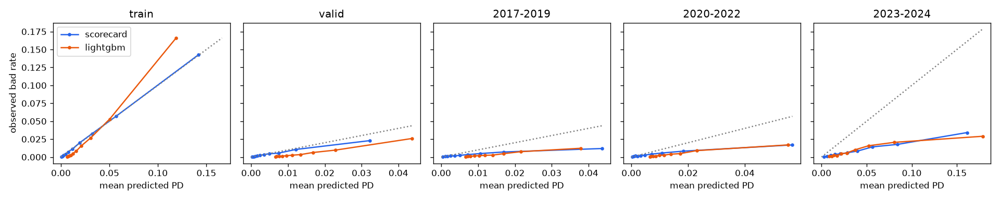

<!-- Template: edit reports/model_comparison.tmpl.md, then `make report`. Every number is a placeholder rendered from outputs/metrics.json or config/. -->

# 模型对比：WOE 评分卡 vs LightGBM

## 结论

1. **跨期区分度两者打平。** 跨期测试段（2017–2024Q2）AUC：评分卡 0.771，LightGBM 0.775，95% 置信区间重叠。LightGBM 在训练段（0.882 对 0.853）和验证段（0.816 对 0.795）领先，到了跨期测试领先基本消失：复杂模型多学到的东西大多没能跨过时间。
2. **排序能力随时间下降，但没有崩。** 两个模型都是训练段最高、验证段次之，测试段里 2017–2019 最低（评分卡 0.745，LightGBM 0.752），之后略有回升。
3. **绝对违约概率严重偏高，不能直接用。** 训练段坏账率 2.80%（含 2008 年危机），测试段只有 0.50%；评分卡在测试段平均预测 1.62%，LightGBM 2.09%。排序可以用，用于定价或额度前必须再校准（下一步稳定性分析）。
4. **两个模型靠的是同一批变量。** 评分卡按信息值（IV）、LightGBM 按增益占比，排前两位都是信用分和利率。利率随利率周期整体平移，是跨期漂移的头号嫌疑，交给稳定性分析看 PSI。

## 设置

- 标签：发放后 24 个月内逾期 90 天以上（逾期状态 ≥ 3）、转 REO 或以损失结清（`config/target.yaml`）；主样本剔除缺陷贷款和窗口内带宽限标记的贷款。
- 切分：按发放季度，相邻段隔 24 个月（`config/split.yaml`）。
- 特征：只用 `config/features.yaml` 里 `available_at: origination` 且 `use: true` 的字段，共 24 个；`make check` 的防泄漏检查对建模表逐列核对。
- 评分卡：训练段分箱（数值最多 10 箱加缺失箱，类别占比不到 1% 的并入其他），IV 低于 0.02 的剔除，留下 13 个进逻辑回归。
- LightGBM：同样的特征，类别字段原样输入；验证段 AUC 早停，停在第 37 轮。
- 置信区间：每段有放回重抽 200 次，取 95% 分位区间。

| 段 | 贷款数 | 坏样本 | 坏账率 |
| --- | --- | --- | --- |
| 训练 2005–2010 | 298,926 | 8,362 | 2.80% |
| 验证 2013–2014 | 99,627 | 529 | 0.53% |
| 测试 2017–2019 | 143,718 | 509 | 0.35% |
| 测试 2020–2022 | 147,136 | 649 | 0.44% |
| 测试 2023–2024Q2 | 69,768 | 645 | 0.92% |
| 测试合计 | 360,622 | 1,803 | 0.50% |

## 区分度（AUC、KS，括号内为置信区间）

| 段 | 评分卡 AUC | LightGBM AUC | 评分卡 KS | LightGBM KS |
| --- | --- | --- | --- | --- |
| 训练 2005–2010 | 0.853 [0.849, 0.857] | 0.882 [0.879, 0.886] | 0.550 [0.540, 0.559] | 0.609 [0.601, 0.618] |
| 验证 2013–2014 | 0.795 [0.776, 0.809] | 0.816 [0.797, 0.831] | 0.445 [0.410, 0.483] | 0.497 [0.466, 0.533] |
| 测试 2017–2019 | 0.745 [0.723, 0.765] | 0.752 [0.734, 0.769] | 0.383 [0.349, 0.429] | 0.394 [0.363, 0.434] |
| 测试 2020–2022 | 0.763 [0.744, 0.781] | 0.766 [0.747, 0.783] | 0.404 [0.383, 0.441] | 0.414 [0.383, 0.451] |
| 测试 2023–2024Q2 | 0.773 [0.756, 0.789] | 0.765 [0.749, 0.781] | 0.424 [0.393, 0.462] | 0.421 [0.400, 0.461] |
| 测试合计 | 0.771 [0.760, 0.783] | 0.775 [0.765, 0.785] | 0.415 [0.395, 0.438] | 0.428 [0.412, 0.449] |

## 校准

| 段 | 实际坏账率 | 评分卡平均预测 | LightGBM 平均预测 | 评分卡 Brier | LightGBM Brier |
| --- | --- | --- | --- | --- | --- |
| 训练 2005–2010 | 2.80% | 2.79% | 2.82% | 0.0251 | 0.0244 |
| 验证 2013–2014 | 0.53% | 0.67% | 1.47% | 0.0053 | 0.0053 |
| 测试 2017–2019 | 0.35% | 0.93% | 1.43% | 0.0037 | 0.0037 |
| 测试 2020–2022 | 0.44% | 1.06% | 1.60% | 0.0046 | 0.0047 |
| 测试 2023–2024Q2 | 0.92% | 4.25% | 4.49% | 0.0117 | 0.0125 |
| 测试合计 | 0.50% | 1.62% | 2.09% | 0.0056 | 0.0058 |

训练段评分卡贴着对角线，LightGBM 在最高风险一组低估；之后各段整体落在对角线下方：模型按危机年份的违约水平给概率，后面的年份实际违约少得多。

## 可解释性

| 特征 | 评分卡 IV | 评分卡系数（WOE 尺度） | LightGBM 增益占比 |
| --- | --- | --- | --- |
| 信用分（`classic_fico`） | 1.137 | 0.804 | 40.5% |
| 利率（`original_interest_rate`） | 0.804 | 0.567 | 17.4% |
| 贷款价值比 LTV（`original_ltv`） | 0.393 | 0.436 | 7.1% |
| 综合 LTV（`original_cltv`） | 0.351 | 0.290 | 4.5% |
| 负债收入比 DTI（`original_dti`） | 0.291 | 0.414 | 4.0% |
| 借款人数（`number_of_borrowers`） | 0.173 | 0.888 | 5.2% |
| 州（`property_state`） | 0.136 | 0.702 | 4.0% |
| 都市区 MSA（`msa`） | 0.048 | 0.549 | 8.8% |
| 渠道（`channel`） | 0.192 | 0.142 | 0.6% |
| 贷款金额（`original_upb`） | 0.025 | 1.450 | 3.6% |

- 评分卡每个特征先换成 WOE，系数为正表示和 WOE 方向一致；系数远离 1 的（如贷款金额）说明和其他特征有重叠，单看系数不能读成「影响大小」。
- LightGBM 给都市区的权重明显高于评分卡：高基数类别容易被树记住地区差异，这部分在跨期上最不稳，是它跨期领先消失的一个候选原因（未验证）。

## 局限

- 验证段同时用于 LightGBM 早停，它在验证段的成绩偏乐观；跨期测试段两个模型都没碰过。
- 置信区间只重抽评估样本，不含训练样本的波动。
- 评分卡分箱没有强制单调，个别箱的 WOE 可能来回跳；要上线前应加单调约束和人工合箱。
- 用的是官方抽样文件（每个发放年随机抽样），不是全量。
