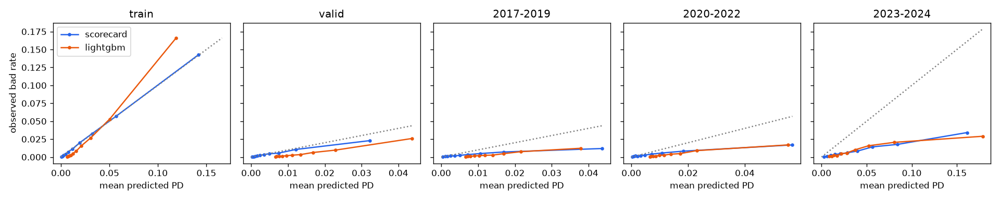

<!-- Template: edit reports/model_comparison.tmpl.md, then `make report`. Every number is a placeholder rendered from outputs/metrics.json or config/. -->

# 模型对比：WOE 评分卡 vs LightGBM

## 结论

1. **跨期区分度两者打平。** 跨期测试段（2017–2024Q2）AUC：评分卡 {{metrics.scorecard.segments.test.auc.est:.3f}}，LightGBM {{metrics.lightgbm.segments.test.auc.est:.3f}}，{{config.model.evaluation.ci_level:.0%}} 置信区间重叠。LightGBM 在训练段（{{metrics.lightgbm.segments.train.auc.est:.3f}} 对 {{metrics.scorecard.segments.train.auc.est:.3f}}）和验证段（{{metrics.lightgbm.segments.valid.auc.est:.3f}} 对 {{metrics.scorecard.segments.valid.auc.est:.3f}}）领先，到了跨期测试领先基本消失：复杂模型多学到的东西大多没能跨过时间。
2. **排序能力随时间下降，但没有崩。** 两个模型都是训练段最高、验证段次之，测试段里 2017–2019 最低（评分卡 {{metrics.scorecard.segments.2017-2019.auc.est:.3f}}，LightGBM {{metrics.lightgbm.segments.2017-2019.auc.est:.3f}}），之后略有回升。
3. **绝对违约概率严重偏高，不能直接用。** 训练段坏账率 {{metrics.sample.train.bad_rate:.2%}}（含 2008 年危机），测试段只有 {{metrics.sample.test.bad_rate:.2%}}；评分卡在测试段平均预测 {{metrics.scorecard.segments.test.mean_pred:.2%}}，LightGBM {{metrics.lightgbm.segments.test.mean_pred:.2%}}。排序可以用，用于定价或额度前必须再校准（下一步稳定性分析）。
4. **两个模型靠的是同一批变量。** 评分卡按信息值（IV）、LightGBM 按增益占比，排前两位都是信用分和利率。利率随利率周期整体平移，是跨期漂移的头号嫌疑，交给稳定性分析看 PSI。

## 设置

- 标签：发放后 {{config.target.performance_months}} 个月内逾期 90 天以上（逾期状态 ≥ {{config.target.bad_if_any_in_window.delinquency_status_min}}）、转 REO 或以损失结清（`config/target.yaml`）；主样本剔除缺陷贷款和窗口内带宽限标记的贷款。
- 切分：按发放季度，相邻段隔 {{config.split.gap_months}} 个月（`config/split.yaml`）。
- 特征：只用 `config/features.yaml` 里 `available_at: origination` 且 `use: true` 的字段，共 {{metrics.scorecard.n_candidates}} 个；`make check` 的防泄漏检查对建模表逐列核对。
- 评分卡：训练段分箱（数值最多 {{config.model.woe.max_bins}} 箱加缺失箱，类别占比不到 {{config.model.woe.min_bin_share:.0%}} 的并入其他），IV 低于 {{config.model.woe.iv_min}} 的剔除，留下 {{metrics.scorecard.n_kept}} 个进逻辑回归。
- LightGBM：同样的特征，类别字段原样输入；验证段 AUC 早停，停在第 {{metrics.lightgbm.best_iteration}} 轮。
- 置信区间：每段有放回重抽 {{config.model.evaluation.bootstrap_reps}} 次，取 {{config.model.evaluation.ci_level:.0%}} 分位区间。

| 段 | 贷款数 | 坏样本 | 坏账率 |
| --- | --- | --- | --- |
| 训练 2005–2010 | {{metrics.sample.train.loans:,}} | {{metrics.sample.train.bads:,}} | {{metrics.sample.train.bad_rate:.2%}} |
| 验证 2013–2014 | {{metrics.sample.valid.loans:,}} | {{metrics.sample.valid.bads:,}} | {{metrics.sample.valid.bad_rate:.2%}} |
| 测试 2017–2019 | {{metrics.sample.2017-2019.loans:,}} | {{metrics.sample.2017-2019.bads:,}} | {{metrics.sample.2017-2019.bad_rate:.2%}} |
| 测试 2020–2022 | {{metrics.sample.2020-2022.loans:,}} | {{metrics.sample.2020-2022.bads:,}} | {{metrics.sample.2020-2022.bad_rate:.2%}} |
| 测试 2023–2024Q2 | {{metrics.sample.2023-2024.loans:,}} | {{metrics.sample.2023-2024.bads:,}} | {{metrics.sample.2023-2024.bad_rate:.2%}} |
| 测试合计 | {{metrics.sample.test.loans:,}} | {{metrics.sample.test.bads:,}} | {{metrics.sample.test.bad_rate:.2%}} |

## 区分度（AUC、KS，括号内为置信区间）

| 段 | 评分卡 AUC | LightGBM AUC | 评分卡 KS | LightGBM KS |
| --- | --- | --- | --- | --- |
| 训练 2005–2010 | {{metrics.scorecard.segments.train.auc.est:.3f}} [{{metrics.scorecard.segments.train.auc.lo:.3f}}, {{metrics.scorecard.segments.train.auc.hi:.3f}}] | {{metrics.lightgbm.segments.train.auc.est:.3f}} [{{metrics.lightgbm.segments.train.auc.lo:.3f}}, {{metrics.lightgbm.segments.train.auc.hi:.3f}}] | {{metrics.scorecard.segments.train.ks.est:.3f}} [{{metrics.scorecard.segments.train.ks.lo:.3f}}, {{metrics.scorecard.segments.train.ks.hi:.3f}}] | {{metrics.lightgbm.segments.train.ks.est:.3f}} [{{metrics.lightgbm.segments.train.ks.lo:.3f}}, {{metrics.lightgbm.segments.train.ks.hi:.3f}}] |
| 验证 2013–2014 | {{metrics.scorecard.segments.valid.auc.est:.3f}} [{{metrics.scorecard.segments.valid.auc.lo:.3f}}, {{metrics.scorecard.segments.valid.auc.hi:.3f}}] | {{metrics.lightgbm.segments.valid.auc.est:.3f}} [{{metrics.lightgbm.segments.valid.auc.lo:.3f}}, {{metrics.lightgbm.segments.valid.auc.hi:.3f}}] | {{metrics.scorecard.segments.valid.ks.est:.3f}} [{{metrics.scorecard.segments.valid.ks.lo:.3f}}, {{metrics.scorecard.segments.valid.ks.hi:.3f}}] | {{metrics.lightgbm.segments.valid.ks.est:.3f}} [{{metrics.lightgbm.segments.valid.ks.lo:.3f}}, {{metrics.lightgbm.segments.valid.ks.hi:.3f}}] |
| 测试 2017–2019 | {{metrics.scorecard.segments.2017-2019.auc.est:.3f}} [{{metrics.scorecard.segments.2017-2019.auc.lo:.3f}}, {{metrics.scorecard.segments.2017-2019.auc.hi:.3f}}] | {{metrics.lightgbm.segments.2017-2019.auc.est:.3f}} [{{metrics.lightgbm.segments.2017-2019.auc.lo:.3f}}, {{metrics.lightgbm.segments.2017-2019.auc.hi:.3f}}] | {{metrics.scorecard.segments.2017-2019.ks.est:.3f}} [{{metrics.scorecard.segments.2017-2019.ks.lo:.3f}}, {{metrics.scorecard.segments.2017-2019.ks.hi:.3f}}] | {{metrics.lightgbm.segments.2017-2019.ks.est:.3f}} [{{metrics.lightgbm.segments.2017-2019.ks.lo:.3f}}, {{metrics.lightgbm.segments.2017-2019.ks.hi:.3f}}] |
| 测试 2020–2022 | {{metrics.scorecard.segments.2020-2022.auc.est:.3f}} [{{metrics.scorecard.segments.2020-2022.auc.lo:.3f}}, {{metrics.scorecard.segments.2020-2022.auc.hi:.3f}}] | {{metrics.lightgbm.segments.2020-2022.auc.est:.3f}} [{{metrics.lightgbm.segments.2020-2022.auc.lo:.3f}}, {{metrics.lightgbm.segments.2020-2022.auc.hi:.3f}}] | {{metrics.scorecard.segments.2020-2022.ks.est:.3f}} [{{metrics.scorecard.segments.2020-2022.ks.lo:.3f}}, {{metrics.scorecard.segments.2020-2022.ks.hi:.3f}}] | {{metrics.lightgbm.segments.2020-2022.ks.est:.3f}} [{{metrics.lightgbm.segments.2020-2022.ks.lo:.3f}}, {{metrics.lightgbm.segments.2020-2022.ks.hi:.3f}}] |
| 测试 2023–2024Q2 | {{metrics.scorecard.segments.2023-2024.auc.est:.3f}} [{{metrics.scorecard.segments.2023-2024.auc.lo:.3f}}, {{metrics.scorecard.segments.2023-2024.auc.hi:.3f}}] | {{metrics.lightgbm.segments.2023-2024.auc.est:.3f}} [{{metrics.lightgbm.segments.2023-2024.auc.lo:.3f}}, {{metrics.lightgbm.segments.2023-2024.auc.hi:.3f}}] | {{metrics.scorecard.segments.2023-2024.ks.est:.3f}} [{{metrics.scorecard.segments.2023-2024.ks.lo:.3f}}, {{metrics.scorecard.segments.2023-2024.ks.hi:.3f}}] | {{metrics.lightgbm.segments.2023-2024.ks.est:.3f}} [{{metrics.lightgbm.segments.2023-2024.ks.lo:.3f}}, {{metrics.lightgbm.segments.2023-2024.ks.hi:.3f}}] |
| 测试合计 | {{metrics.scorecard.segments.test.auc.est:.3f}} [{{metrics.scorecard.segments.test.auc.lo:.3f}}, {{metrics.scorecard.segments.test.auc.hi:.3f}}] | {{metrics.lightgbm.segments.test.auc.est:.3f}} [{{metrics.lightgbm.segments.test.auc.lo:.3f}}, {{metrics.lightgbm.segments.test.auc.hi:.3f}}] | {{metrics.scorecard.segments.test.ks.est:.3f}} [{{metrics.scorecard.segments.test.ks.lo:.3f}}, {{metrics.scorecard.segments.test.ks.hi:.3f}}] | {{metrics.lightgbm.segments.test.ks.est:.3f}} [{{metrics.lightgbm.segments.test.ks.lo:.3f}}, {{metrics.lightgbm.segments.test.ks.hi:.3f}}] |

## 校准

| 段 | 实际坏账率 | 评分卡平均预测 | LightGBM 平均预测 | 评分卡 Brier | LightGBM Brier |
| --- | --- | --- | --- | --- | --- |
| 训练 2005–2010 | {{metrics.sample.train.bad_rate:.2%}} | {{metrics.scorecard.segments.train.mean_pred:.2%}} | {{metrics.lightgbm.segments.train.mean_pred:.2%}} | {{metrics.scorecard.segments.train.brier:.4f}} | {{metrics.lightgbm.segments.train.brier:.4f}} |
| 验证 2013–2014 | {{metrics.sample.valid.bad_rate:.2%}} | {{metrics.scorecard.segments.valid.mean_pred:.2%}} | {{metrics.lightgbm.segments.valid.mean_pred:.2%}} | {{metrics.scorecard.segments.valid.brier:.4f}} | {{metrics.lightgbm.segments.valid.brier:.4f}} |
| 测试 2017–2019 | {{metrics.sample.2017-2019.bad_rate:.2%}} | {{metrics.scorecard.segments.2017-2019.mean_pred:.2%}} | {{metrics.lightgbm.segments.2017-2019.mean_pred:.2%}} | {{metrics.scorecard.segments.2017-2019.brier:.4f}} | {{metrics.lightgbm.segments.2017-2019.brier:.4f}} |
| 测试 2020–2022 | {{metrics.sample.2020-2022.bad_rate:.2%}} | {{metrics.scorecard.segments.2020-2022.mean_pred:.2%}} | {{metrics.lightgbm.segments.2020-2022.mean_pred:.2%}} | {{metrics.scorecard.segments.2020-2022.brier:.4f}} | {{metrics.lightgbm.segments.2020-2022.brier:.4f}} |
| 测试 2023–2024Q2 | {{metrics.sample.2023-2024.bad_rate:.2%}} | {{metrics.scorecard.segments.2023-2024.mean_pred:.2%}} | {{metrics.lightgbm.segments.2023-2024.mean_pred:.2%}} | {{metrics.scorecard.segments.2023-2024.brier:.4f}} | {{metrics.lightgbm.segments.2023-2024.brier:.4f}} |
| 测试合计 | {{metrics.sample.test.bad_rate:.2%}} | {{metrics.scorecard.segments.test.mean_pred:.2%}} | {{metrics.lightgbm.segments.test.mean_pred:.2%}} | {{metrics.scorecard.segments.test.brier:.4f}} | {{metrics.lightgbm.segments.test.brier:.4f}} |

训练段评分卡贴着对角线，LightGBM 在最高风险一组低估；之后各段整体落在对角线下方：模型按危机年份的违约水平给概率，后面的年份实际违约少得多。

## 可解释性

| 特征 | 评分卡 IV | 评分卡系数（WOE 尺度） | LightGBM 增益占比 |
| --- | --- | --- | --- |
| 信用分（`classic_fico`） | {{metrics.scorecard.features.classic_fico.iv:.3f}} | {{metrics.scorecard.features.classic_fico.coef:.3f}} | {{metrics.lightgbm.gain_share.classic_fico:.1%}} |
| 利率（`original_interest_rate`） | {{metrics.scorecard.features.original_interest_rate.iv:.3f}} | {{metrics.scorecard.features.original_interest_rate.coef:.3f}} | {{metrics.lightgbm.gain_share.original_interest_rate:.1%}} |
| 贷款价值比 LTV（`original_ltv`） | {{metrics.scorecard.features.original_ltv.iv:.3f}} | {{metrics.scorecard.features.original_ltv.coef:.3f}} | {{metrics.lightgbm.gain_share.original_ltv:.1%}} |
| 综合 LTV（`original_cltv`） | {{metrics.scorecard.features.original_cltv.iv:.3f}} | {{metrics.scorecard.features.original_cltv.coef:.3f}} | {{metrics.lightgbm.gain_share.original_cltv:.1%}} |
| 负债收入比 DTI（`original_dti`） | {{metrics.scorecard.features.original_dti.iv:.3f}} | {{metrics.scorecard.features.original_dti.coef:.3f}} | {{metrics.lightgbm.gain_share.original_dti:.1%}} |
| 借款人数（`number_of_borrowers`） | {{metrics.scorecard.features.number_of_borrowers.iv:.3f}} | {{metrics.scorecard.features.number_of_borrowers.coef:.3f}} | {{metrics.lightgbm.gain_share.number_of_borrowers:.1%}} |
| 州（`property_state`） | {{metrics.scorecard.features.property_state.iv:.3f}} | {{metrics.scorecard.features.property_state.coef:.3f}} | {{metrics.lightgbm.gain_share.property_state:.1%}} |
| 都市区 MSA（`msa`） | {{metrics.scorecard.features.msa.iv:.3f}} | {{metrics.scorecard.features.msa.coef:.3f}} | {{metrics.lightgbm.gain_share.msa:.1%}} |
| 渠道（`channel`） | {{metrics.scorecard.features.channel.iv:.3f}} | {{metrics.scorecard.features.channel.coef:.3f}} | {{metrics.lightgbm.gain_share.channel:.1%}} |
| 贷款金额（`original_upb`） | {{metrics.scorecard.features.original_upb.iv:.3f}} | {{metrics.scorecard.features.original_upb.coef:.3f}} | {{metrics.lightgbm.gain_share.original_upb:.1%}} |

- 评分卡每个特征先换成 WOE，系数为正表示和 WOE 方向一致；系数远离 1 的（如贷款金额）说明和其他特征有重叠，单看系数不能读成「影响大小」。
- LightGBM 给都市区的权重明显高于评分卡：高基数类别容易被树记住地区差异，这部分在跨期上最不稳，是它跨期领先消失的一个候选原因（未验证）。

## 局限

- 验证段同时用于 LightGBM 早停，它在验证段的成绩偏乐观；跨期测试段两个模型都没碰过。
- 置信区间只重抽评估样本，不含训练样本的波动。
- 评分卡分箱没有强制单调，个别箱的 WOE 可能来回跳；要上线前应加单调约束和人工合箱。
- 用的是官方抽样文件（每个发放年随机抽样），不是全量。
