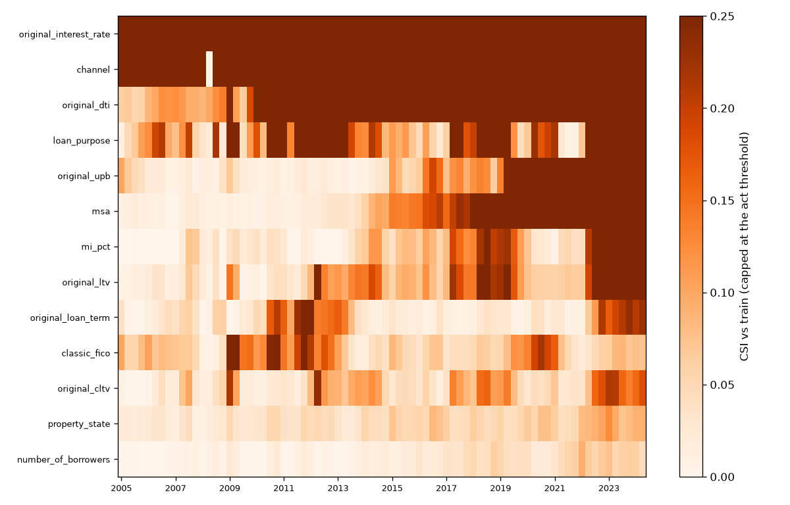
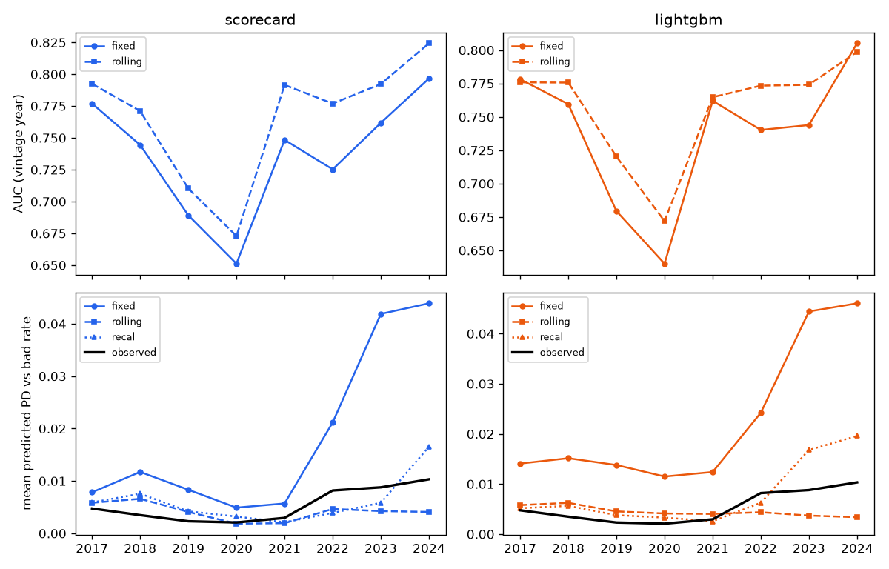
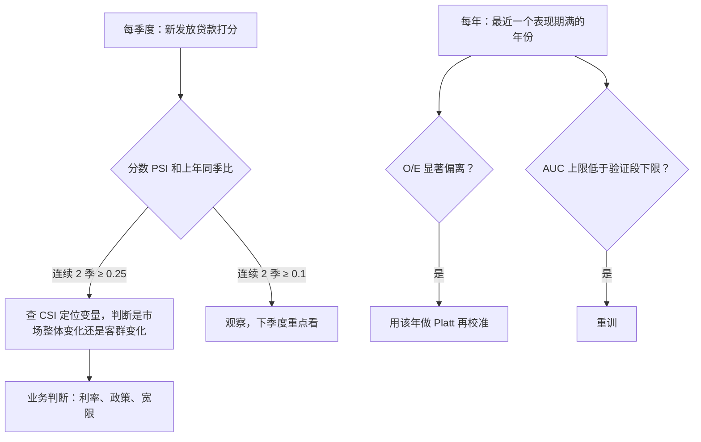

<!-- Template: edit reports/stability.tmpl.md, then `make report`. Every number is a placeholder rendered from outputs/stability.json, outputs/metrics.json or config/. -->

# 跨期稳定性与再校准规则

## 结论

1. **模型确实在老化，评分卡尤其明显，每年重训能补回来。** 每年用最近的数据重训（滚动重训）和 2005–2010 训练一次就不动（固定模型）相比，评分卡在 2018、2019、2021、2022、2023、2024 这几年 AUC 显著更高（配对差的 95% 区间整个在 0 以上），LightGBM 只有 2019、2022、2023（树模型对老化没那么敏感，但区间也更宽）。这部分是「模型老了」，靠重训能修。
2. **但 2019–2020 这两年是环境问题，重训也救不回来。** 这两年发放的贷款，24 个月表现期正好撞上疫情宽限：固定模型 AUC 掉到 0.651（评分卡）/ 0.640（LightGBM），滚动重训也只有 0.673 / 0.672。同期大量贷款带宽限标记（2019 年发放的含宽限坏账率 4.61%，剔除后 0.23%），标签本身变了，不是模型的问题。
3. **训练集里的金融危机拖累了后面的表现。** 去掉 2007、2008、2009 年的发放重训固定模型，评分卡在 2018、2019、2022、2023、2024 年 AUC 显著更高，LightGBM 在 2022、2023、2024 年；平均预测违约率也大约减半（2023 年评分卡 4.19% → 2.01%，实际 0.88%）。
4. **以训练期为基准的 PSI 一直在报警，当不了触发器；改用「和上年同季比」才有用。** 分数 PSI 相对训练期，测试期 30 个季度里评分卡有 27 个、LightGBM 有 27 个超过 0.25，最高到 1.96（2020Q3）。主因是利率：测试期利率的 CSI 平均 5.73，2012–2021 年低利率、2023 年后回到训练期水平，而利率是两个模型都很倚重的变量。和上年同季比，评分卡的行动信号集中在 2009 年危机和 2022Q3–2023Q3 加息两段（完整列表见第 5 节），测试期只有 7 个季度超 0.25、14 个超 0.1。
5. **概率偏高要定期再校准，但单靠「用 3 年前数据做一次 Platt」校不准。** 固定模型每一年的「实际坏样本 / 预测坏样本」（O/E）都显著低于 1（评分卡 2023 年只有 0.21）。用最近一个表现期已满的年份（Y−3）做 Platt 再校准后，Brier 分数在评分卡 2017、2018、2019、2020、2021、2022、2023、2024 年都下降，但仍然显著偏离（评分卡 2017、2018、2019、2020、2021、2022、2023、2024）：2022 年反而低估（O/E 2.09），因为拿来校准的 2019 年剔除宽限后坏账率极低。违约水平跟着利率、房价和政策走，校准要配合下面的规则和人工判断。

## 设置

- 模型：直接重用 `MULT-415` 的两个模型（同一配置、同一随机种子重训，测试段 AUC 与 `outputs/metrics.json` 一致，代码里有断言）。
- 样本：2005Q1–2024Q2 每个发放季度的主样本（剔除缺陷贷款和窗口内带宽限 / 灾害标记的贷款），共 78 个季度，每季度至少 8,325 笔；含建模时没用的隔离年（2011–2012、2015–2016）。
- PSI：分数按训练段十分位分箱，每季度和训练段比，同时和上年同一季度比。CSI：评分卡入模特征按训练段的 WOE 分箱，同样和训练段比。阈值 0.1 / 0.25 来自常量白名单（行业惯例）。
- 季度 AUC：坏样本不到 30 个的季度留空（汇总表里也是空）。
- 滚动重训：对第 Y 年，用 Y−8 到 Y−4 年训练，LightGBM 在 Y−3 年早停；Y−3 年第四季度加 24 个月不晚于 Y 年第一季度，满足隔离规则。
- 置信区间：每年有放回重抽 500 次，同一年各模型变体共用重抽样本，差值是配对的。
- 校准偏离：实际坏样本数和预测坏样本数之差除以其标准差得 z，|z| 超过 95% 正态分位数即判偏离。

## 1 按季度 PSI、CSI、AUC

| 特征 | 测试期平均 CSI | 峰值（季度） |
| --- | --- | --- |
| `original_interest_rate` | 5.734 | 11.417（2021Q4） |
| `channel` | 4.138 | 4.333（2023Q4） |
| `original_dti` | 1.738 | 2.403（2023Q4） |
| `loan_purpose` | 0.482 | 1.302（2023Q3） |
| `msa` | 0.477 | 0.695（2024Q1） |
| `original_upb` | 0.405 | 0.732（2024Q1） |
| `classic_fico` | 0.081 | 0.301（2011Q4） |
| `original_ltv` | 0.191 | 0.398（2023Q1） |

- 利率漂移最大，是 `MULT-415` 留下的「加息后概率偏高」假设的直接证据：模型把高利率读成高风险，而 2023 年后的高利率是市场整体利率，不是借款人风险。
- 渠道（`channel`）的 CSI 也很高，可能是数据里渠道编码或第三方渠道占比变了，待在字段手册里核实，暂不下结论。
- 贷款用途在 2023 年跳升，符合加息后再融资消失、购房贷款占比上升；DTI 上移符合放宽 DTI 上限后的人群变化（两条都是推断，未逐条核实）。

## 2 固定模型逐年测 vs 每年滚动重训

括号内为 95% 置信区间；差值 = 滚动 − 固定，区间整个大于 0 说明重训显著更好。

| 发放年 | 坏样本 | 评分卡 固定 | 评分卡 滚动 | 评分卡 差值 | LightGBM 固定 | LightGBM 滚动 | LightGBM 差值 |
| --- | --- | --- | --- | --- | --- | --- | --- |
| 2017 | 235 | 0.777 [0.750, 0.804] | 0.792 [0.765, 0.820] | 0.0155 [-0.0010, 0.0299] | 0.778 [0.754, 0.804] | 0.776 [0.750, 0.803] | -0.0023 [-0.0163, 0.0116] |
| 2018 | 166 | 0.744 [0.708, 0.782] | 0.771 [0.735, 0.807] | 0.0267 [0.0092, 0.0425] | 0.760 [0.724, 0.794] | 0.776 [0.743, 0.809] | 0.0161 [-0.0052, 0.0381] |
| 2019 | 108 | 0.689 [0.638, 0.741] | 0.710 [0.660, 0.764] | 0.0211 [0.0007, 0.0417] | 0.679 [0.628, 0.729] | 0.720 [0.673, 0.765] | 0.0408 [0.0044, 0.0761] |
| 2020 | 102 | 0.651 [0.593, 0.706] | 0.673 [0.615, 0.728] | 0.0217 [-0.0049, 0.0496] | 0.640 [0.577, 0.693] | 0.672 [0.616, 0.723] | 0.0319 [-0.0017, 0.0673] |
| 2021 | 146 | 0.748 [0.708, 0.788] | 0.792 [0.759, 0.826] | 0.0432 [0.0208, 0.0628] | 0.762 [0.722, 0.800] | 0.765 [0.722, 0.805] | 0.0027 [-0.0227, 0.0241] |
| 2022 | 401 | 0.725 [0.702, 0.749] | 0.777 [0.755, 0.799] | 0.0517 [0.0352, 0.0693] | 0.740 [0.717, 0.762] | 0.773 [0.750, 0.796] | 0.0332 [0.0128, 0.0525] |
| 2023 | 432 | 0.762 [0.740, 0.782] | 0.792 [0.773, 0.811] | 0.0305 [0.0137, 0.0455] | 0.744 [0.726, 0.765] | 0.774 [0.754, 0.794] | 0.0301 [0.0111, 0.0481] |
| 2024Q1–Q2 | 213 | 0.797 [0.771, 0.819] | 0.824 [0.801, 0.846] | 0.0277 [0.0047, 0.0526] | 0.805 [0.779, 0.830] | 0.799 [0.771, 0.828] | -0.0063 [-0.0333, 0.0246] |

怎么读：固定和滚动一起掉的年份（2019–2020）是环境变化；滚动明显更高的年份是模型老化。

## 3 危机期和疫情宽限期

按时期汇总（固定模型，PSI 相对训练段）：

| 时期 | 贷款数 | 坏账率 | 评分卡 PSI | 评分卡 AUC | 评分卡 O/E | LightGBM PSI | LightGBM AUC | LightGBM O/E |
| --- | --- | --- | --- | --- | --- | --- | --- | --- |
| 危机期 2007Q1–2009Q4 | 149,293 | 3.57% | 0.002 | 0.867 | 1.26 | 0.001 | 0.893 | 1.24 |
| 疫情宽限期 2020Q1–2021Q4 | 98,160 | 0.25% | 1.202 | 0.710 | 0.48 | 0.944 | 0.713 | 0.21 |
| 其余季度 | 710,715 | 0.87% | 0.140 | 0.821 | 0.55 | 0.078 | 0.846 | 0.42 |

危机期在训练段里，所以它的 PSI 低、O/E 最接近 1；疫情期 O/E 远低于 1。

**训练时去掉危机年份**（差值 = 去掉危机 − 原模型；箭头是平均预测违约率的变化）：

| 发放年 | 评分卡 AUC 差值 | 评分卡 平均预测 | LightGBM AUC 差值 | LightGBM 平均预测 |
| --- | --- | --- | --- | --- |
| 2017 | 0.0084 [-0.0021, 0.0193] | 0.78% → 0.79% | 0.0006 [-0.0123, 0.0114] | 1.41% → 1.51% |
| 2018 | 0.0165 [0.0042, 0.0289] | 1.17% → 1.03% | -0.0005 [-0.0142, 0.0123] | 1.51% → 1.55% |
| 2019 | 0.0133 [0.0006, 0.0275] | 0.83% → 0.76% | 0.0062 [-0.0115, 0.0240] | 1.38% → 1.46% |
| 2020 | -0.0003 [-0.0124, 0.0141] | 0.49% → 0.46% | 0.0009 [-0.0257, 0.0235] | 1.15% → 1.32% |
| 2021 | 0.0104 [-0.0014, 0.0230] | 0.57% → 0.53% | -0.0048 [-0.0193, 0.0100] | 1.24% → 1.39% |
| 2022 | 0.0349 [0.0269, 0.0433] | 2.12% → 1.34% | 0.0224 [0.0126, 0.0320] | 2.42% → 1.80% |
| 2023 | 0.0146 [0.0067, 0.0232] | 4.19% → 2.01% | 0.0211 [0.0118, 0.0294] | 4.44% → 2.32% |
| 2024Q1–Q2 | 0.0156 [0.0036, 0.0269] | 4.39% → 2.05% | 0.0234 [0.0081, 0.0393] | 4.61% → 2.32% |

**评估时含不含宽限贷款**（固定模型；箭头是剔除 → 含宽限）：

| 发放年 | 坏账率（剔除） | 坏账率（含宽限） | 评分卡 AUC | 评分卡 O/E | LightGBM AUC | LightGBM O/E |
| --- | --- | --- | --- | --- | --- | --- |
| 2017 | 0.47% | 1.03% | 0.777 → 0.800 | 0.61 → 1.29 | 0.778 → 0.802 | 0.34 → 0.72 |
| 2018 | 0.35% | 2.65% | 0.744 → 0.739 | 0.30 → 2.13 | 0.760 → 0.739 | 0.23 → 1.70 |
| 2019 | 0.23% | 4.61% | 0.689 → 0.712 | 0.28 → 5.18 | 0.679 → 0.706 | 0.17 → 3.24 |
| 2020 | 0.21% | 1.63% | 0.651 → 0.730 | 0.43 → 3.23 | 0.640 → 0.721 | 0.18 → 1.40 |
| 2021 | 0.30% | 0.97% | 0.748 → 0.777 | 0.52 → 1.67 | 0.762 → 0.778 | 0.24 → 0.78 |
| 2022 | 0.82% | 1.79% | 0.725 → 0.728 | 0.39 → 0.83 | 0.740 → 0.738 | 0.34 → 0.73 |
| 2023 | 0.88% | 1.70% | 0.762 → 0.766 | 0.21 → 0.40 | 0.744 → 0.754 | 0.20 → 0.38 |
| 2024Q1–Q2 | 1.03% | 1.68% | 0.797 → 0.793 | 0.24 → 0.38 | 0.805 → 0.796 | 0.22 → 0.36 |

含宽限时 2018–2020 年的「坏账率」被宽限期间的逾期状态大幅抬高（Freddie Mac 的逾期状态按应还日算，宽限期的贷款会显示逾期），这些不是真违约，所以主结果剔除。代价是剔除后这几年坏样本很少，结论区间宽。

## 4 校准与再校准

O/E = 实际坏样本 / 预测坏样本，1 为完全校准；Brier 箭头是固定 → 固定 + 再校准。

| 发放年 | 实际坏账率 | 评分卡 固定 | 评分卡 再校准 | 评分卡 滚动 | 评分卡 Brier | LightGBM 固定 | LightGBM 再校准 | LightGBM 滚动 | LightGBM Brier |
| --- | --- | --- | --- | --- | --- | --- | --- | --- | --- |
| 2017 | 0.47% | 0.61 | 0.80 | 0.81 | 0.00477 → 0.00471 | 0.34 | 0.92 | 0.82 | 0.00480 → 0.00471 |
| 2018 | 0.35% | 0.30 | 0.46 | 0.53 | 0.00375 → 0.00353 | 0.23 | 0.62 | 0.56 | 0.00367 → 0.00359 |
| 2019 | 0.23% | 0.28 | 0.55 | 0.57 | 0.00250 → 0.00233 | 0.17 | 0.61 | 0.51 | 0.00251 → 0.00239 |
| 2020 | 0.21% | 0.43 | 0.65 | 1.12 | 0.00213 → 0.00209 | 0.18 | 0.63 | 0.51 | 0.00220 → 0.00210 |
| 2021 | 0.30% | 0.52 | 1.39 | 1.51 | 0.00296 → 0.00294 | 0.24 | 1.15 | 0.73 | 0.00304 → 0.00294 |
| 2022 | 0.82% | 0.39 | 2.09 | 1.75 | 0.00883 → 0.00810 | 0.34 | 1.31 | 1.88 | 0.00893 → 0.00822 |
| 2023 | 0.88% | 0.21 | 1.51 | 2.07 | 0.01124 → 0.00868 | 0.20 | 0.52 | 2.38 | 0.01204 → 0.00941 |
| 2024Q1–Q2 | 1.03% | 0.24 | 0.62 | 2.52 | 0.01285 → 0.01014 | 0.22 | 0.53 | 3.06 | 0.01351 → 0.01100 |

- 再校准方法：对固定模型的 logit 分数做逻辑回归（Platt），用 Y−3 年（Y 年部署时表现期已满的最近一年）拟合。
- 滚动重训的模型也不准：它学的是 5 年训练窗的平均违约水平，同样跟不上逐年变化。

## 5 再校准触发规则

| 规则 | 数据 | 触发条件 | 动作 | 回测（2017–2024Q2） |
| --- | --- | --- | --- | --- |
| R1 分数漂移 | 当季新发放，不需要标签 | 分数 PSI 和上年同季比，连续 2 季 ≥ 0.25 行动、≥ 0.1 观察 | 用 CSI 找原因 | 评分卡行动 2009Q1、2009Q2、2009Q3、2009Q4、2010Q4、2022Q3、2022Q4、2023Q1、2023Q2、2023Q3；LightGBM 行动 2009Q1、2009Q2、2009Q3、2009Q4、2022Q3、2022Q4、2023Q1、2023Q2、2023Q3 |
| R2 校准偏离 | 表现期已满的最近一年 | O/E 的 z 超出 95% 区间 | Platt 再校准 | 评分卡 2017、2018、2019、2020、2021、2022、2023、2024；LightGBM 2017、2018、2019、2020、2021、2022、2023、2024 |
| R3 区分度下降 | 同上 | 当年 AUC 区间上限低于验证段 AUC 区间下限 | 重训 | 评分卡 2019、2020、2022；LightGBM 2018、2019、2020、2022、2023 |

- 阈值：PSI 的 0.1 / 0.25 来自常量白名单；连续季度数和置信水平是本项目的设置（`config/stability.yaml`、`config/model.yaml`）。
- R1 不和训练期比，是因为和训练期比几乎每季度都超阈值（结论 4），规则就失去了区分意义。
- R2、R3 有天然滞后：Y 年发放的贷款要到 Y+3 年初表现期才满，所以 2022 年的问题最早 2025 年才看得到。这正是 R1 的价值：它当季就能报。
- 回测里 R2 年年触发，R3 集中在疫情和加息前后，意思是「固定模型不该一直不动」：建议每年按 R2 再校准、按 R3 评估是否重训；评分卡滚动重训在 2018、2019、2021、2022、2023、2024 年都显著更好，建议直接改成每年重训。

## 局限

- 主样本每年 5 万笔抽样，2019–2021 年坏样本只有一两百个，逐年区间宽。2020、2021 年的全量数据已下载，可以用来复核这两年，本单没做（见 `MULT-416` 评论）。
- 再校准只试了 Platt 一种；按利率分层校准、或把市场利率作为特征（用相对利率代替绝对利率）可能更好，留给后续。
- 渠道 CSI 的原因没有核实。
