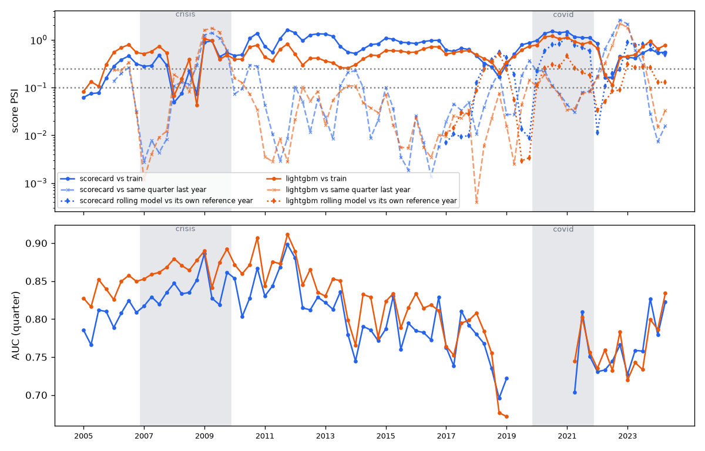
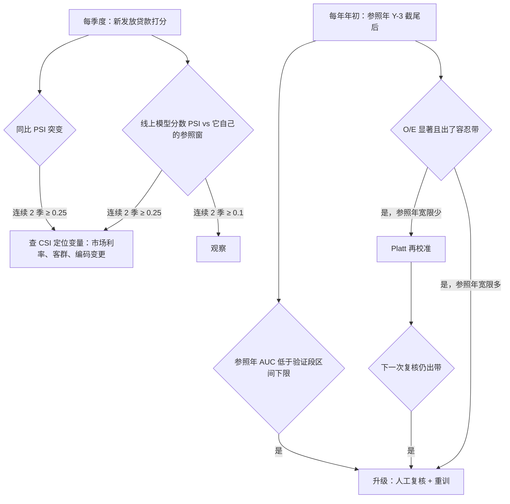

<!-- Template: edit reports/stability.tmpl.md, then `make report`. Every number is a placeholder rendered from outputs/stability.json, outputs/metrics.json or config/. -->

# 跨期稳定性与再校准规则

## 结论

1. **固定模型（2005–2010 训练一次不动）的区分度在下降，但大半是训练集里的危机年份造成的，不全是「老化」。** 每年用最近数据重训（滚动重训）比固定模型显著更好的年份：评分卡 2018、2019、2021、2022、2023、2024，LightGBM 2019、2022、2023。但只把 2007、2008、2009 年从训练集去掉（其余照旧用老数据），就能拿回很大一部分：评分卡 2018、2019、2022、2023、2024 年、LightGBM 2022、2023、2024 年显著更好。滚动重训再比「去掉危机」显著更好的，只有评分卡 2021、2022、2023 年；LightGBM 没有一年，2024 年反而是「去掉危机」更好（2024）。纯「老化」只在评分卡上看得到，而且幅度小于危机样本的影响。
2. **2019–2020 年主样本 AUC 下跌，主要是「事后剔除宽限贷款」带来的样本选择偏差，叠加疫情冲击，不是模型本身的问题。** 主样本剔除了表现期内带宽限标记的贷款，2019 年发放的坏账率因此从 4.61% 降到 0.23%，大部分潜在违约者被拿掉了。不剔除时，评分卡 2019、2020 年 AUC 是 0.712、0.730，高于主样本的 0.689、0.651。滚动重训在这两年仍有提升（评分卡 2019 年 0.0211），但它的训练数据也在疫情前，没法用它单独分出「环境」和「老化」。
3. **训练集含危机年份，是概率偏高的主要来源之一。** 去掉危机年份后平均预测违约率大约减半（2023 年评分卡 4.19% → 2.01%，实际 0.88%）。
4. **漂移监控要和「线上模型自己的参照窗」比，不能和 2005–2010 的训练期比。** 和训练期比，测试期 30 个季度里两个模型都有 27 个超过 0.25，形同常亮，主因是利率（测试期利率 CSI 平均 4.65）。改成「当年线上的滚动模型」和「它自己的参照年」比，评分卡连续两季超 0.25 的季度落在 2018Q3–2019Q1、2020Q3–2021Q4 和 2023Q2 以后，对应 2018 年底加息、疫情期再融资潮和 2023 年加息后的客群变化。这些是真实的客群移动，所以 R1 的动作是「查原因」，不是直接重训。和上年同季比只作短期突变的辅助信号：它在高利率持续一年后就会熄火（2023Q4 以后不再报警，而固定模型此时仍严重高估）。
5. **按真实滞后跑的再校准闭环校不准，要升级到重训加人工判断。** 第 Y 年年初只能看到 Y−3 年（表现期已满）的结果。按这个时点逐年回测 R2：没有一年不触发；2021、2022、2023 年的参照年宽限贷款占比超过 2%，保护规则拦下了 Platt（不拦的话评分卡 2022 年会从高估变成低估，O/E 2.01）。执行后 O/E 落进容忍带（0.8–1.25）的只有 2017 年。违约水平随利率、房价和政策逐年变化，3 年前的数据追不上。

## 设置

- 模型：直接重用 `MULT-415` 的两个模型（同一配置、同一随机种子重训，测试段 AUC 与 `outputs/metrics.json` 一致，代码里有断言）。
- 样本：2005Q1–2024Q2 每个发放季度的主样本（剔除缺陷贷款和窗口内带宽限 / 灾害标记的贷款），共 78 个季度，每季度至少 8,325 笔，含建模时没用的隔离年。
- 部署时点：回测第 Y 年时假设模型在 Y 年年初上线，只能用到 Y−1 年 12 月前表现期已满的标签（首次还款月 + 24 − 1 个月不晚于 Y−1 年 12 月）。滚动重训、Platt 拟合和 R2、R3 判定都按这个截尾。
- PSI / CSI：分数按参照窗的十分位分箱；CSI 用评分卡入模特征的 WOE 分箱。空箱用一个很小的占比代替以免除零，所以空箱多的变量（如编码改过的渠道）PSI 和 CSI 会偏大，只看相对大小。阈值 0.1 / 0.25 来自常量白名单（行业惯例）。
- 季度 AUC：坏样本不到 30 个的季度留空。
- 滚动重训：第 Y 年用 Y−8 到 Y−4 年训练，LightGBM 在 Y−3 年（截尾后）早停；训练年和早停年之间不隔离。
- 置信区间：每年有放回重抽 500 次，同一年各模型变体共用重抽样本，差值是配对的。
- 校准偏离：实际坏样本数和预测坏样本数之差除以其标准差得 z，|z| 超过 95% 正态分位数为显著。

## 1 按季度 PSI、CSI、AUC

评分卡全部入模特征，按测试期平均 CSI 排序：

| 特征 | 测试期平均 CSI | 峰值（季度） |
| --- | --- | --- |
| `original_interest_rate` | 4.655 | 8.124（2021Q1） |
| `channel` | 2.724 | 2.919（2023Q4） |
| `original_dti` | 1.207 | 1.586（2023Q4） |
| `loan_purpose` | 0.482 | 1.302（2023Q3） |
| `original_upb` | 0.405 | 0.732（2024Q1） |
| `msa` | 0.329 | 0.500（2024Q1） |
| `original_ltv` | 0.191 | 0.398（2023Q1） |
| `mi_pct` | 0.179 | 0.404（2023Q1） |
| `original_cltv` | 0.102 | 0.234（2012Q2） |
| `classic_fico` | 0.081 | 0.299（2011Q4） |
| `original_loan_term` | 0.067 | 0.338（2011Q4） |
| `property_state` | 0.066 | 0.127（2023Q1） |
| `number_of_borrowers` | 0.047 | 0.092（2022Q1） |

- 利率漂移最大，支持 `MULT-415` 留下的假设：模型把高利率读成高风险，而 2023 年后的高利率是市场整体利率，不是借款人风险。
- 渠道（`channel`）是编码变更，不是客群变化：2005–2008 年几乎全部记为「第三方、未细分」，2009 年起拆成经纪和代理两类。评分卡把这个编码切换当成了风险信号，建议在模型里合并这几类（交 `MULT-415` 的后续迭代）。
- 贷款用途在 2023 年跳升，符合加息后再融资消失、购房贷款占比上升；DTI 上移符合放宽 DTI 上限后的人群变化（两条都是推断，未逐条核实）。

## 2 模型老化还是危机样本：固定、去掉危机、滚动重训

AUC 点估计；最后一列是滚动 − 去掉危机的配对差和 95% 区间，整个大于 0 才算「重训比只去掉危机更好」，也就是纯老化。

| 发放年 | 坏样本 | 评分卡 固定 | 评分卡 去掉危机 | 评分卡 滚动 | 评分卡 滚动 − 去掉危机 | LightGBM 固定 | LightGBM 去掉危机 | LightGBM 滚动 | LightGBM 滚动 − 去掉危机 |
| --- | --- | --- | --- | --- | --- | --- | --- | --- | --- |
| 2017 | 235 | 0.777 | 0.785 | 0.793 | 0.0072 [-0.0073, 0.0207] | 0.778 | 0.779 | 0.776 | -0.0030 [-0.0180, 0.0136] |
| 2018 | 166 | 0.744 | 0.761 | 0.771 | 0.0102 [-0.0037, 0.0226] | 0.760 | 0.759 | 0.774 | 0.0149 [-0.0066, 0.0381] |
| 2019 | 108 | 0.689 | 0.702 | 0.710 | 0.0078 [-0.0106, 0.0287] | 0.679 | 0.686 | 0.719 | 0.0331 [-0.0036, 0.0660] |
| 2020 | 102 | 0.651 | 0.651 | 0.673 | 0.0221 [-0.0046, 0.0456] | 0.640 | 0.641 | 0.662 | 0.0208 [-0.0114, 0.0496] |
| 2021 | 146 | 0.748 | 0.759 | 0.792 | 0.0328 [0.0139, 0.0504] | 0.762 | 0.757 | 0.775 | 0.0176 [-0.0034, 0.0357] |
| 2022 | 401 | 0.725 | 0.760 | 0.777 | 0.0167 [0.0031, 0.0333] | 0.740 | 0.763 | 0.773 | 0.0100 [-0.0076, 0.0260] |
| 2023 | 432 | 0.762 | 0.776 | 0.792 | 0.0159 [0.0018, 0.0291] | 0.744 | 0.765 | 0.776 | 0.0109 [-0.0051, 0.0279] |
| 2024Q1–Q2 | 213 | 0.797 | 0.812 | 0.824 | 0.0120 [-0.0060, 0.0330] | 0.805 | 0.829 | 0.799 | -0.0297 [-0.0526, -0.0045] |

## 3 危机期和疫情宽限期

按时期汇总（固定模型，PSI 相对训练段）：

| 时期 | 贷款数 | 坏账率 | 评分卡 PSI | 评分卡 AUC | 评分卡 O/E | LightGBM PSI | LightGBM AUC | LightGBM O/E |
| --- | --- | --- | --- | --- | --- | --- | --- | --- |
| 危机期 2007Q1–2009Q4 | 149,293 | 3.57% | 0.002 | 0.867 | 1.26 | 0.001 | 0.893 | 1.24 |
| 疫情宽限期 2020Q1–2021Q4 | 98,160 | 0.25% | 1.202 | 0.710 | 0.48 | 0.944 | 0.713 | 0.21 |
| 其余季度 | 710,715 | 0.87% | 0.140 | 0.821 | 0.55 | 0.078 | 0.846 | 0.42 |

危机期在训练段里，所以它的 PSI 低、O/E 最接近 1；疫情期 O/E 远低于 1。

**训练时去掉危机年份**（差值 = 去掉危机 − 固定；箭头是平均预测违约率的变化）：

| 发放年 | 评分卡 AUC 差值 | 评分卡 平均预测 | LightGBM AUC 差值 | LightGBM 平均预测 |
| --- | --- | --- | --- | --- |
| 2017 | 0.0084 [-0.0021, 0.0193] | 0.78% → 0.79% | 0.0006 [-0.0123, 0.0114] | 1.41% → 1.51% |
| 2018 | 0.0165 [0.0042, 0.0289] | 1.17% → 1.03% | -0.0005 [-0.0142, 0.0123] | 1.51% → 1.55% |
| 2019 | 0.0133 [0.0006, 0.0275] | 0.83% → 0.76% | 0.0062 [-0.0115, 0.0240] | 1.38% → 1.46% |
| 2020 | -0.0003 [-0.0124, 0.0141] | 0.49% → 0.46% | 0.0009 [-0.0257, 0.0235] | 1.15% → 1.32% |
| 2021 | 0.0104 [-0.0014, 0.0230] | 0.57% → 0.53% | -0.0048 [-0.0193, 0.0100] | 1.24% → 1.39% |
| 2022 | 0.0349 [0.0269, 0.0433] | 2.12% → 1.34% | 0.0224 [0.0126, 0.0320] | 2.42% → 1.80% |
| 2023 | 0.0146 [0.0067, 0.0232] | 4.19% → 2.01% | 0.0211 [0.0118, 0.0294] | 4.44% → 2.32% |
| 2024Q1–Q2 | 0.0156 [0.0036, 0.0269] | 4.39% → 2.05% | 0.0234 [0.0081, 0.0393] | 4.61% → 2.32% |

**评估时含不含宽限贷款**（固定模型；箭头是剔除 → 含宽限）：

| 发放年 | 坏账率（剔除） | 坏账率（含宽限） | 评分卡 AUC | 评分卡 O/E | LightGBM AUC | LightGBM O/E |
| --- | --- | --- | --- | --- | --- | --- |
| 2017 | 0.47% | 1.03% | 0.777 → 0.800 | 0.61 → 1.29 | 0.778 → 0.802 | 0.34 → 0.72 |
| 2018 | 0.35% | 2.65% | 0.744 → 0.739 | 0.30 → 2.13 | 0.760 → 0.739 | 0.23 → 1.70 |
| 2019 | 0.23% | 4.61% | 0.689 → 0.712 | 0.28 → 5.18 | 0.679 → 0.706 | 0.17 → 3.24 |
| 2020 | 0.21% | 1.63% | 0.651 → 0.730 | 0.43 → 3.23 | 0.640 → 0.721 | 0.18 → 1.40 |
| 2021 | 0.30% | 0.97% | 0.748 → 0.777 | 0.52 → 1.67 | 0.762 → 0.778 | 0.24 → 0.78 |
| 2022 | 0.82% | 1.79% | 0.725 → 0.728 | 0.39 → 0.83 | 0.740 → 0.738 | 0.34 → 0.73 |
| 2023 | 0.88% | 1.70% | 0.762 → 0.766 | 0.21 → 0.40 | 0.744 → 0.754 | 0.20 → 0.38 |
| 2024Q1–Q2 | 1.03% | 1.68% | 0.797 → 0.793 | 0.24 → 0.38 | 0.805 → 0.796 | 0.22 → 0.36 |

两种口径各有偏差：含宽限时，宽限期内按应还日显示的「逾期」会被算成违约（Freddie Mac 的逾期状态按应还日算）；剔除时，是在事后按表现期内的宽限标记剔除，宽限贷款里本来就多是会出问题的借款人，剔掉后剩下的样本偏好、坏样本很少。2018–2020 年两种口径差异最大，这几年的结论要两种一起看。

## 4 再校准：按真实滞后的逐年闭环

第 Y 年年初：用参照年（Y−3，截尾后）判定 R2，触发就用参照年做 Platt（对固定模型的 logit 分数做逻辑回归），作用于 Y 年新发放贷款。括号里是参照年的宽限贷款占比；O/E = 实际坏样本 / 预测坏样本，1 为完全校准。

| 发放年 Y | 参照年（宽限占比） | 评分卡 参照年 O/E | 评分卡 R2 | 评分卡 Y 年 O/E：固定 → 执行后 | LightGBM 参照年 O/E | LightGBM R2 | LightGBM Y 年 O/E：固定 → 执行后 |
| --- | --- | --- | --- | --- | --- | --- | --- |
| 2017 | 2014（0.3%） | 0.75 | recalibrate | 0.61 → 0.81（不加保护 0.81） | 0.39 | recalibrate | 0.34 → 0.93（不加保护 0.93） |
| 2018 | 2015（0.4%） | 0.68 | recalibrate | 0.30 → 0.41（不加保护 0.41） | 0.30 | recalibrate | 0.23 → 0.62（不加保护 0.62） |
| 2019 | 2016（0.8%） | 0.54 | recalibrate | 0.28 → 0.54（不加保护 0.54） | 0.25 | recalibrate | 0.17 → 0.60（不加保护 0.60） |
| 2020 | 2017（0.9%） | 0.58 | recalibrate | 0.43 → 0.68（不加保护 0.68） | 0.32 | recalibrate | 0.18 → 0.65（不加保护 0.65） |
| 2021 | 2018（4.3%） | 0.30 | escalate | 0.52 → 0.52（不加保护 1.40） | 0.23 | escalate | 0.24 → 0.24（不加保护 1.14） |
| 2022 | 2019（6.6%） | 0.29 | escalate | 0.39 → 0.39（不加保护 2.01） | 0.18 | escalate | 0.34 → 0.34（不加保护 1.28） |
| 2023 | 2020（2.3%） | 0.43 | escalate | 0.21 → 0.21（不加保护 1.43） | 0.19 | escalate | 0.20 → 0.20（不加保护 0.52） |
| 2024Q1–Q2 | 2021（1.1%） | 0.50 | recalibrate | 0.24 → 0.65（不加保护 0.65） | 0.23 | recalibrate | 0.22 → 0.54（不加保护 0.54） |

- R2 取值：recalibrate 是做 Platt；escalate 是参照年宽限占比超过 2%，不做 Platt，升级到人工复核和重训。
- Platt 在每一年都降低了 Brier 分数（评分卡 2017、2018、2019、2020、2021、2022、2023、2024），但执行后 O/E 进入容忍带的只有 2017 年（LightGBM 2017 年）。
- 滚动重训的模型同样不准：它学的是 5 年训练窗的平均违约水平，同样跟不上逐年变化。

## 5 再校准触发规则

| 规则 | 数据 | 触发条件 | 动作 | 回测（2017–2024Q2，按部署时点） |
| --- | --- | --- | --- | --- |
| R1 分数漂移（主） | 当季新发放，不需要标签 | 线上模型分数和它自己的参照窗比，连续 2 季 ≥ 0.25 行动、≥ 0.1 观察 | 用 CSI 查原因 | 评分卡行动 2018Q3、2018Q4、2019Q1、2020Q3、2020Q4、2021Q1、2021Q2、2021Q3、2021Q4、2023Q2、2023Q3、2023Q4、2024Q1、2024Q2；LightGBM 行动 2018Q4、2020Q3、2020Q4、2021Q1、2021Q2、2023Q2、2023Q3、2023Q4 |
| R1b 同比突变（辅） | 同上 | 和上年同季比，连续 2 季 ≥ 0.25 | 同上 | 评分卡 2022Q3、2022Q4、2023Q1、2023Q2、2023Q3；LightGBM 2022Q3、2022Q4、2023Q1、2023Q2、2023Q3 |
| R2 校准偏离 | 参照年 Y−3（截尾后） | O/E 的 z 超出 95% 区间，且 O/E 出了 0.8–1.25 | 参照年宽限占比不超过 2% 做 Platt，否则升级 | 评分卡 Platt 2017、2018、2019、2020、2024、升级 2021、2022、2023 |
| R3 区分度下降 | 同上 | 参照年 AUC 低于验证段 AUC 区间下限 | 重训 | 评分卡 2017、2020、2021、2022、2023、2024；LightGBM 2020、2021、2022、2023、2024 |

- 阈值：PSI 的 0.1 / 0.25 来自常量白名单；连续季度数、O/E 容忍带、宽限占比上限和置信水平是本项目的设置（`config/stability.yaml`、`config/model.yaml`）。
- R1 的「参照窗」就是线上模型最近一次重训或再校准用的那一年。回测里线上模型按每年滚动重训算。
- R2、R3 有天然滞后：Y 年发放的贷款到 Y+3 年初才能拿来判定，这正是 R1 的价值。
- 回测结论：R2 年年触发、执行后多数年份仍出带，R3 多数年份触发。固定模型加年度 Platt 不够，建议改成每年重训（训练集不含危机年份），加上利率等宏观因素的人工判断。

## 局限

- 主样本每年 5 万笔抽样，2019–2021 年坏样本只有一两百个，逐年区间宽。2020、2021 年的全量数据已下载，可以用来复核这两年，本单没做。
- 再校准只试了 Platt 一种。按利率分层校准、或用相对利率（借款利率减当期市场利率）代替绝对利率，可能更好，留给后续。
- 端到端测试只覆盖了辅助函数和截尾、R2 判定逻辑，`quarterly`、`annual` 没有合成数据的整体测试。
