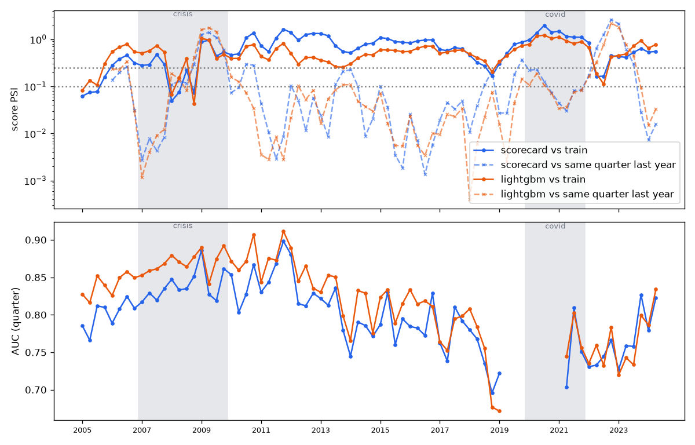
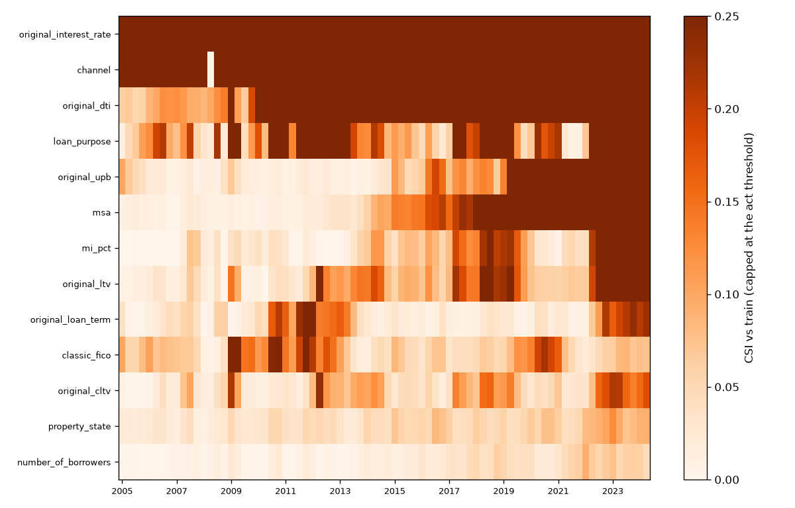
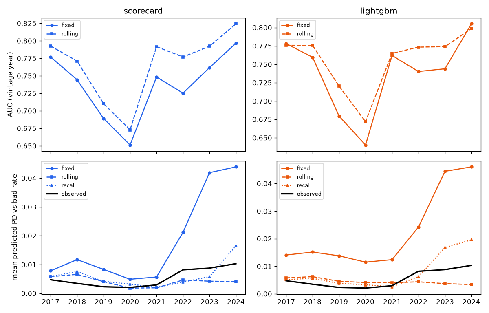
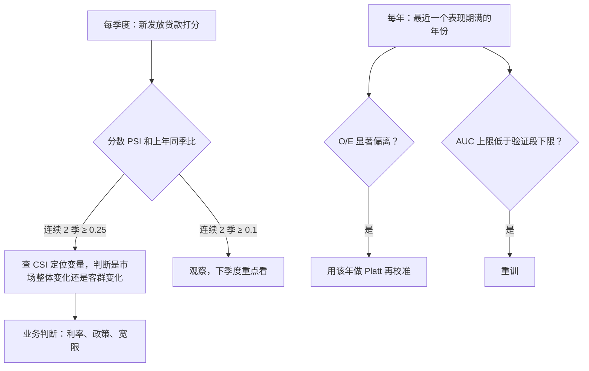

<!-- Template: edit reports/stability.tmpl.md, then `make report`. Every number is a placeholder rendered from outputs/stability.json, outputs/metrics.json or config/. -->

# 跨期稳定性与再校准规则

## 结论

1. **模型确实在老化，评分卡尤其明显，每年重训能补回来。** 每年用最近的数据重训（滚动重训）和 2005–2010 训练一次就不动（固定模型）相比，评分卡在 {{stability.rules.scorecard.years_rolling_better}} 这几年 AUC 显著更高（配对差的 {{config.model.evaluation.ci_level:.0%}} 区间整个在 0 以上），LightGBM 只有 {{stability.rules.lightgbm.years_rolling_better}}（树模型对老化没那么敏感，但区间也更宽）。这部分是「模型老了」，靠重训能修。
2. **但 2019–2020 这两年是环境问题，重训也救不回来。** 这两年发放的贷款，24 个月表现期正好撞上疫情宽限：固定模型 AUC 掉到 {{stability.annual.2020.scorecard.fixed.auc.est:.3f}}（评分卡）/ {{stability.annual.2020.lightgbm.fixed.auc.est:.3f}}（LightGBM），滚动重训也只有 {{stability.annual.2020.scorecard.rolling.auc.est:.3f}} / {{stability.annual.2020.lightgbm.rolling.auc.est:.3f}}。同期大量贷款带宽限标记（2019 年发放的含宽限坏账率 {{stability.annual.2019.sample.bad_rate_incl_assisted:.2%}}，剔除后 {{stability.annual.2019.sample.bad_rate:.2%}}），标签本身变了，不是模型的问题。
3. **训练集里的金融危机拖累了后面的表现。** 去掉 {{config.stability.crisis_sensitivity.drop_years}} 年的发放重训固定模型，评分卡在 {{stability.rules.scorecard.years_no_crisis_better}} 年 AUC 显著更高，LightGBM 在 {{stability.rules.lightgbm.years_no_crisis_better}} 年；平均预测违约率也大约减半（2023 年评分卡 {{stability.annual.2023.scorecard.fixed.mean_pred:.2%}} → {{stability.annual.2023.scorecard.no_crisis.mean_pred:.2%}}，实际 {{stability.annual.2023.sample.bad_rate:.2%}}）。
4. **以训练期为基准的 PSI 一直在报警，当不了触发器；改用「和上年同季比」才有用。** 分数 PSI 相对训练期，测试期 {{stability.quarters.test}} 个季度里评分卡有 {{stability.rules.scorecard.test_quarters_act}} 个、LightGBM 有 {{stability.rules.lightgbm.test_quarters_act}} 个超过 {{stability.psi_thresholds.1}}，最高到 {{stability.rules.scorecard.psi_max:.2f}}（{{stability.rules.scorecard.psi_max_quarter}}）。主因是利率：测试期利率的 CSI 平均 {{stability.csi_mean_test.original_interest_rate:.2f}}，2012–2021 年低利率、2023 年后回到训练期水平，而利率是两个模型都很倚重的变量。和上年同季比，评分卡的行动信号集中在 2009 年危机和 2022Q3–2023Q3 加息两段（完整列表见第 5 节），测试期只有 {{stability.rules.scorecard.yoy_test_quarters_act}} 个季度超 {{stability.psi_thresholds.1}}、{{stability.rules.scorecard.yoy_test_quarters_watch}} 个超 {{stability.psi_thresholds.0}}。
5. **概率偏高要定期再校准，但单靠「用 3 年前数据做一次 Platt」校不准。** 固定模型每一年的「实际坏样本 / 预测坏样本」（O/E）都显著低于 1（评分卡 2023 年只有 {{stability.annual.2023.scorecard.fixed.oe:.2f}}）。用最近一个表现期已满的年份（Y−{{config.stability.recalibration.fit_year_back}}）做 Platt 再校准后，Brier 分数在评分卡 {{stability.rules.scorecard.years_recal_brier_better}} 年都下降，但仍然显著偏离（评分卡 {{stability.rules.scorecard.years_recal_still_off}}）：2022 年反而低估（O/E {{stability.annual.2022.scorecard.recal.oe:.2f}}），因为拿来校准的 2019 年剔除宽限后坏账率极低。违约水平跟着利率、房价和政策走，校准要配合下面的规则和人工判断。

## 设置

- 模型：直接重用 `MULT-415` 的两个模型（同一配置、同一随机种子重训，测试段 AUC 与 `outputs/metrics.json` 一致，代码里有断言）。
- 样本：2005Q1–2024Q2 每个发放季度的主样本（剔除缺陷贷款和窗口内带宽限 / 灾害标记的贷款），共 {{stability.quarters.n}} 个季度，每季度至少 {{stability.quarters.min_loans:,}} 笔；含建模时没用的隔离年（2011–2012、2015–2016）。
- PSI：分数按训练段十分位分箱，每季度和训练段比，同时和上年同一季度比。CSI：评分卡入模特征按训练段的 WOE 分箱，同样和训练段比。阈值 {{stability.psi_thresholds.0}} / {{stability.psi_thresholds.1}} 来自常量白名单（行业惯例）。
- 季度 AUC：坏样本不到 {{config.stability.min_bads_for_auc}} 个的季度留空（汇总表里也是空）。
- 滚动重训：对第 Y 年，用 Y−{{config.stability.rolling.train_years_back.0}} 到 Y−{{config.stability.rolling.train_years_back.1}} 年训练，LightGBM 在 Y−{{config.stability.rolling.valid_year_back}} 年早停；Y−{{config.stability.rolling.valid_year_back}} 年第四季度加 {{config.split.gap_months}} 个月不晚于 Y 年第一季度，满足隔离规则。
- 置信区间：每年有放回重抽 {{config.stability.bootstrap_reps}} 次，同一年各模型变体共用重抽样本，差值是配对的。
- 校准偏离：实际坏样本数和预测坏样本数之差除以其标准差得 z，|z| 超过 {{config.model.evaluation.ci_level:.0%}} 正态分位数即判偏离。

## 1 按季度 PSI、CSI、AUC

| 特征 | 测试期平均 CSI | 峰值（季度） |
| --- | --- | --- |
| `original_interest_rate` | {{stability.csi_mean_test.original_interest_rate:.3f}} | {{stability.csi_peak.original_interest_rate.csi:.3f}}（{{stability.csi_peak.original_interest_rate.quarter}}） |
| `channel` | {{stability.csi_mean_test.channel:.3f}} | {{stability.csi_peak.channel.csi:.3f}}（{{stability.csi_peak.channel.quarter}}） |
| `original_dti` | {{stability.csi_mean_test.original_dti:.3f}} | {{stability.csi_peak.original_dti.csi:.3f}}（{{stability.csi_peak.original_dti.quarter}}） |
| `loan_purpose` | {{stability.csi_mean_test.loan_purpose:.3f}} | {{stability.csi_peak.loan_purpose.csi:.3f}}（{{stability.csi_peak.loan_purpose.quarter}}） |
| `msa` | {{stability.csi_mean_test.msa:.3f}} | {{stability.csi_peak.msa.csi:.3f}}（{{stability.csi_peak.msa.quarter}}） |
| `original_upb` | {{stability.csi_mean_test.original_upb:.3f}} | {{stability.csi_peak.original_upb.csi:.3f}}（{{stability.csi_peak.original_upb.quarter}}） |
| `classic_fico` | {{stability.csi_mean_test.classic_fico:.3f}} | {{stability.csi_peak.classic_fico.csi:.3f}}（{{stability.csi_peak.classic_fico.quarter}}） |
| `original_ltv` | {{stability.csi_mean_test.original_ltv:.3f}} | {{stability.csi_peak.original_ltv.csi:.3f}}（{{stability.csi_peak.original_ltv.quarter}}） |

- 利率漂移最大，是 `MULT-415` 留下的「加息后概率偏高」假设的直接证据：模型把高利率读成高风险，而 2023 年后的高利率是市场整体利率，不是借款人风险。
- 渠道（`channel`）的 CSI 也很高，可能是数据里渠道编码或第三方渠道占比变了，待在字段手册里核实，暂不下结论。
- 贷款用途在 2023 年跳升，符合加息后再融资消失、购房贷款占比上升；DTI 上移符合放宽 DTI 上限后的人群变化（两条都是推断，未逐条核实）。

## 2 固定模型逐年测 vs 每年滚动重训

括号内为 {{config.model.evaluation.ci_level:.0%}} 置信区间；差值 = 滚动 − 固定，区间整个大于 0 说明重训显著更好。

| 发放年 | 坏样本 | 评分卡 固定 | 评分卡 滚动 | 评分卡 差值 | LightGBM 固定 | LightGBM 滚动 | LightGBM 差值 |
| --- | --- | --- | --- | --- | --- | --- | --- |
| 2017 | {{stability.annual.2017.sample.bads:,}} | {{stability.annual.2017.scorecard.fixed.auc.est:.3f}} [{{stability.annual.2017.scorecard.fixed.auc.lo:.3f}}, {{stability.annual.2017.scorecard.fixed.auc.hi:.3f}}] | {{stability.annual.2017.scorecard.rolling.auc.est:.3f}} [{{stability.annual.2017.scorecard.rolling.auc.lo:.3f}}, {{stability.annual.2017.scorecard.rolling.auc.hi:.3f}}] | {{stability.annual.2017.scorecard.delta_rolling_minus_fixed.est:.4f}} [{{stability.annual.2017.scorecard.delta_rolling_minus_fixed.lo:.4f}}, {{stability.annual.2017.scorecard.delta_rolling_minus_fixed.hi:.4f}}] | {{stability.annual.2017.lightgbm.fixed.auc.est:.3f}} [{{stability.annual.2017.lightgbm.fixed.auc.lo:.3f}}, {{stability.annual.2017.lightgbm.fixed.auc.hi:.3f}}] | {{stability.annual.2017.lightgbm.rolling.auc.est:.3f}} [{{stability.annual.2017.lightgbm.rolling.auc.lo:.3f}}, {{stability.annual.2017.lightgbm.rolling.auc.hi:.3f}}] | {{stability.annual.2017.lightgbm.delta_rolling_minus_fixed.est:.4f}} [{{stability.annual.2017.lightgbm.delta_rolling_minus_fixed.lo:.4f}}, {{stability.annual.2017.lightgbm.delta_rolling_minus_fixed.hi:.4f}}] |
| 2018 | {{stability.annual.2018.sample.bads:,}} | {{stability.annual.2018.scorecard.fixed.auc.est:.3f}} [{{stability.annual.2018.scorecard.fixed.auc.lo:.3f}}, {{stability.annual.2018.scorecard.fixed.auc.hi:.3f}}] | {{stability.annual.2018.scorecard.rolling.auc.est:.3f}} [{{stability.annual.2018.scorecard.rolling.auc.lo:.3f}}, {{stability.annual.2018.scorecard.rolling.auc.hi:.3f}}] | {{stability.annual.2018.scorecard.delta_rolling_minus_fixed.est:.4f}} [{{stability.annual.2018.scorecard.delta_rolling_minus_fixed.lo:.4f}}, {{stability.annual.2018.scorecard.delta_rolling_minus_fixed.hi:.4f}}] | {{stability.annual.2018.lightgbm.fixed.auc.est:.3f}} [{{stability.annual.2018.lightgbm.fixed.auc.lo:.3f}}, {{stability.annual.2018.lightgbm.fixed.auc.hi:.3f}}] | {{stability.annual.2018.lightgbm.rolling.auc.est:.3f}} [{{stability.annual.2018.lightgbm.rolling.auc.lo:.3f}}, {{stability.annual.2018.lightgbm.rolling.auc.hi:.3f}}] | {{stability.annual.2018.lightgbm.delta_rolling_minus_fixed.est:.4f}} [{{stability.annual.2018.lightgbm.delta_rolling_minus_fixed.lo:.4f}}, {{stability.annual.2018.lightgbm.delta_rolling_minus_fixed.hi:.4f}}] |
| 2019 | {{stability.annual.2019.sample.bads:,}} | {{stability.annual.2019.scorecard.fixed.auc.est:.3f}} [{{stability.annual.2019.scorecard.fixed.auc.lo:.3f}}, {{stability.annual.2019.scorecard.fixed.auc.hi:.3f}}] | {{stability.annual.2019.scorecard.rolling.auc.est:.3f}} [{{stability.annual.2019.scorecard.rolling.auc.lo:.3f}}, {{stability.annual.2019.scorecard.rolling.auc.hi:.3f}}] | {{stability.annual.2019.scorecard.delta_rolling_minus_fixed.est:.4f}} [{{stability.annual.2019.scorecard.delta_rolling_minus_fixed.lo:.4f}}, {{stability.annual.2019.scorecard.delta_rolling_minus_fixed.hi:.4f}}] | {{stability.annual.2019.lightgbm.fixed.auc.est:.3f}} [{{stability.annual.2019.lightgbm.fixed.auc.lo:.3f}}, {{stability.annual.2019.lightgbm.fixed.auc.hi:.3f}}] | {{stability.annual.2019.lightgbm.rolling.auc.est:.3f}} [{{stability.annual.2019.lightgbm.rolling.auc.lo:.3f}}, {{stability.annual.2019.lightgbm.rolling.auc.hi:.3f}}] | {{stability.annual.2019.lightgbm.delta_rolling_minus_fixed.est:.4f}} [{{stability.annual.2019.lightgbm.delta_rolling_minus_fixed.lo:.4f}}, {{stability.annual.2019.lightgbm.delta_rolling_minus_fixed.hi:.4f}}] |
| 2020 | {{stability.annual.2020.sample.bads:,}} | {{stability.annual.2020.scorecard.fixed.auc.est:.3f}} [{{stability.annual.2020.scorecard.fixed.auc.lo:.3f}}, {{stability.annual.2020.scorecard.fixed.auc.hi:.3f}}] | {{stability.annual.2020.scorecard.rolling.auc.est:.3f}} [{{stability.annual.2020.scorecard.rolling.auc.lo:.3f}}, {{stability.annual.2020.scorecard.rolling.auc.hi:.3f}}] | {{stability.annual.2020.scorecard.delta_rolling_minus_fixed.est:.4f}} [{{stability.annual.2020.scorecard.delta_rolling_minus_fixed.lo:.4f}}, {{stability.annual.2020.scorecard.delta_rolling_minus_fixed.hi:.4f}}] | {{stability.annual.2020.lightgbm.fixed.auc.est:.3f}} [{{stability.annual.2020.lightgbm.fixed.auc.lo:.3f}}, {{stability.annual.2020.lightgbm.fixed.auc.hi:.3f}}] | {{stability.annual.2020.lightgbm.rolling.auc.est:.3f}} [{{stability.annual.2020.lightgbm.rolling.auc.lo:.3f}}, {{stability.annual.2020.lightgbm.rolling.auc.hi:.3f}}] | {{stability.annual.2020.lightgbm.delta_rolling_minus_fixed.est:.4f}} [{{stability.annual.2020.lightgbm.delta_rolling_minus_fixed.lo:.4f}}, {{stability.annual.2020.lightgbm.delta_rolling_minus_fixed.hi:.4f}}] |
| 2021 | {{stability.annual.2021.sample.bads:,}} | {{stability.annual.2021.scorecard.fixed.auc.est:.3f}} [{{stability.annual.2021.scorecard.fixed.auc.lo:.3f}}, {{stability.annual.2021.scorecard.fixed.auc.hi:.3f}}] | {{stability.annual.2021.scorecard.rolling.auc.est:.3f}} [{{stability.annual.2021.scorecard.rolling.auc.lo:.3f}}, {{stability.annual.2021.scorecard.rolling.auc.hi:.3f}}] | {{stability.annual.2021.scorecard.delta_rolling_minus_fixed.est:.4f}} [{{stability.annual.2021.scorecard.delta_rolling_minus_fixed.lo:.4f}}, {{stability.annual.2021.scorecard.delta_rolling_minus_fixed.hi:.4f}}] | {{stability.annual.2021.lightgbm.fixed.auc.est:.3f}} [{{stability.annual.2021.lightgbm.fixed.auc.lo:.3f}}, {{stability.annual.2021.lightgbm.fixed.auc.hi:.3f}}] | {{stability.annual.2021.lightgbm.rolling.auc.est:.3f}} [{{stability.annual.2021.lightgbm.rolling.auc.lo:.3f}}, {{stability.annual.2021.lightgbm.rolling.auc.hi:.3f}}] | {{stability.annual.2021.lightgbm.delta_rolling_minus_fixed.est:.4f}} [{{stability.annual.2021.lightgbm.delta_rolling_minus_fixed.lo:.4f}}, {{stability.annual.2021.lightgbm.delta_rolling_minus_fixed.hi:.4f}}] |
| 2022 | {{stability.annual.2022.sample.bads:,}} | {{stability.annual.2022.scorecard.fixed.auc.est:.3f}} [{{stability.annual.2022.scorecard.fixed.auc.lo:.3f}}, {{stability.annual.2022.scorecard.fixed.auc.hi:.3f}}] | {{stability.annual.2022.scorecard.rolling.auc.est:.3f}} [{{stability.annual.2022.scorecard.rolling.auc.lo:.3f}}, {{stability.annual.2022.scorecard.rolling.auc.hi:.3f}}] | {{stability.annual.2022.scorecard.delta_rolling_minus_fixed.est:.4f}} [{{stability.annual.2022.scorecard.delta_rolling_minus_fixed.lo:.4f}}, {{stability.annual.2022.scorecard.delta_rolling_minus_fixed.hi:.4f}}] | {{stability.annual.2022.lightgbm.fixed.auc.est:.3f}} [{{stability.annual.2022.lightgbm.fixed.auc.lo:.3f}}, {{stability.annual.2022.lightgbm.fixed.auc.hi:.3f}}] | {{stability.annual.2022.lightgbm.rolling.auc.est:.3f}} [{{stability.annual.2022.lightgbm.rolling.auc.lo:.3f}}, {{stability.annual.2022.lightgbm.rolling.auc.hi:.3f}}] | {{stability.annual.2022.lightgbm.delta_rolling_minus_fixed.est:.4f}} [{{stability.annual.2022.lightgbm.delta_rolling_minus_fixed.lo:.4f}}, {{stability.annual.2022.lightgbm.delta_rolling_minus_fixed.hi:.4f}}] |
| 2023 | {{stability.annual.2023.sample.bads:,}} | {{stability.annual.2023.scorecard.fixed.auc.est:.3f}} [{{stability.annual.2023.scorecard.fixed.auc.lo:.3f}}, {{stability.annual.2023.scorecard.fixed.auc.hi:.3f}}] | {{stability.annual.2023.scorecard.rolling.auc.est:.3f}} [{{stability.annual.2023.scorecard.rolling.auc.lo:.3f}}, {{stability.annual.2023.scorecard.rolling.auc.hi:.3f}}] | {{stability.annual.2023.scorecard.delta_rolling_minus_fixed.est:.4f}} [{{stability.annual.2023.scorecard.delta_rolling_minus_fixed.lo:.4f}}, {{stability.annual.2023.scorecard.delta_rolling_minus_fixed.hi:.4f}}] | {{stability.annual.2023.lightgbm.fixed.auc.est:.3f}} [{{stability.annual.2023.lightgbm.fixed.auc.lo:.3f}}, {{stability.annual.2023.lightgbm.fixed.auc.hi:.3f}}] | {{stability.annual.2023.lightgbm.rolling.auc.est:.3f}} [{{stability.annual.2023.lightgbm.rolling.auc.lo:.3f}}, {{stability.annual.2023.lightgbm.rolling.auc.hi:.3f}}] | {{stability.annual.2023.lightgbm.delta_rolling_minus_fixed.est:.4f}} [{{stability.annual.2023.lightgbm.delta_rolling_minus_fixed.lo:.4f}}, {{stability.annual.2023.lightgbm.delta_rolling_minus_fixed.hi:.4f}}] |
| 2024Q1–Q2 | {{stability.annual.2024.sample.bads:,}} | {{stability.annual.2024.scorecard.fixed.auc.est:.3f}} [{{stability.annual.2024.scorecard.fixed.auc.lo:.3f}}, {{stability.annual.2024.scorecard.fixed.auc.hi:.3f}}] | {{stability.annual.2024.scorecard.rolling.auc.est:.3f}} [{{stability.annual.2024.scorecard.rolling.auc.lo:.3f}}, {{stability.annual.2024.scorecard.rolling.auc.hi:.3f}}] | {{stability.annual.2024.scorecard.delta_rolling_minus_fixed.est:.4f}} [{{stability.annual.2024.scorecard.delta_rolling_minus_fixed.lo:.4f}}, {{stability.annual.2024.scorecard.delta_rolling_minus_fixed.hi:.4f}}] | {{stability.annual.2024.lightgbm.fixed.auc.est:.3f}} [{{stability.annual.2024.lightgbm.fixed.auc.lo:.3f}}, {{stability.annual.2024.lightgbm.fixed.auc.hi:.3f}}] | {{stability.annual.2024.lightgbm.rolling.auc.est:.3f}} [{{stability.annual.2024.lightgbm.rolling.auc.lo:.3f}}, {{stability.annual.2024.lightgbm.rolling.auc.hi:.3f}}] | {{stability.annual.2024.lightgbm.delta_rolling_minus_fixed.est:.4f}} [{{stability.annual.2024.lightgbm.delta_rolling_minus_fixed.lo:.4f}}, {{stability.annual.2024.lightgbm.delta_rolling_minus_fixed.hi:.4f}}] |

怎么读：固定和滚动一起掉的年份（2019–2020）是环境变化；滚动明显更高的年份是模型老化。

## 3 危机期和疫情宽限期

按时期汇总（固定模型，PSI 相对训练段）：

| 时期 | 贷款数 | 坏账率 | 评分卡 PSI | 评分卡 AUC | 评分卡 O/E | LightGBM PSI | LightGBM AUC | LightGBM O/E |
| --- | --- | --- | --- | --- | --- | --- | --- | --- |
| 危机期 {{config.stability.periods.crisis.start}}–{{config.stability.periods.crisis.end}} | {{stability.periods.crisis.loans:,}} | {{stability.periods.crisis.bad_rate:.2%}} | {{stability.periods.crisis.scorecard.psi:.3f}} | {{stability.periods.crisis.scorecard.auc:.3f}} | {{stability.periods.crisis.scorecard.oe:.2f}} | {{stability.periods.crisis.lightgbm.psi:.3f}} | {{stability.periods.crisis.lightgbm.auc:.3f}} | {{stability.periods.crisis.lightgbm.oe:.2f}} |
| 疫情宽限期 {{config.stability.periods.covid.start}}–{{config.stability.periods.covid.end}} | {{stability.periods.covid.loans:,}} | {{stability.periods.covid.bad_rate:.2%}} | {{stability.periods.covid.scorecard.psi:.3f}} | {{stability.periods.covid.scorecard.auc:.3f}} | {{stability.periods.covid.scorecard.oe:.2f}} | {{stability.periods.covid.lightgbm.psi:.3f}} | {{stability.periods.covid.lightgbm.auc:.3f}} | {{stability.periods.covid.lightgbm.oe:.2f}} |
| 其余季度 | {{stability.periods.normal.loans:,}} | {{stability.periods.normal.bad_rate:.2%}} | {{stability.periods.normal.scorecard.psi:.3f}} | {{stability.periods.normal.scorecard.auc:.3f}} | {{stability.periods.normal.scorecard.oe:.2f}} | {{stability.periods.normal.lightgbm.psi:.3f}} | {{stability.periods.normal.lightgbm.auc:.3f}} | {{stability.periods.normal.lightgbm.oe:.2f}} |

危机期在训练段里，所以它的 PSI 低、O/E 最接近 1；疫情期 O/E 远低于 1。

**训练时去掉危机年份**（差值 = 去掉危机 − 原模型；箭头是平均预测违约率的变化）：

| 发放年 | 评分卡 AUC 差值 | 评分卡 平均预测 | LightGBM AUC 差值 | LightGBM 平均预测 |
| --- | --- | --- | --- | --- |
| 2017 | {{stability.annual.2017.scorecard.delta_no_crisis_minus_fixed.est:.4f}} [{{stability.annual.2017.scorecard.delta_no_crisis_minus_fixed.lo:.4f}}, {{stability.annual.2017.scorecard.delta_no_crisis_minus_fixed.hi:.4f}}] | {{stability.annual.2017.scorecard.fixed.mean_pred:.2%}} → {{stability.annual.2017.scorecard.no_crisis.mean_pred:.2%}} | {{stability.annual.2017.lightgbm.delta_no_crisis_minus_fixed.est:.4f}} [{{stability.annual.2017.lightgbm.delta_no_crisis_minus_fixed.lo:.4f}}, {{stability.annual.2017.lightgbm.delta_no_crisis_minus_fixed.hi:.4f}}] | {{stability.annual.2017.lightgbm.fixed.mean_pred:.2%}} → {{stability.annual.2017.lightgbm.no_crisis.mean_pred:.2%}} |
| 2018 | {{stability.annual.2018.scorecard.delta_no_crisis_minus_fixed.est:.4f}} [{{stability.annual.2018.scorecard.delta_no_crisis_minus_fixed.lo:.4f}}, {{stability.annual.2018.scorecard.delta_no_crisis_minus_fixed.hi:.4f}}] | {{stability.annual.2018.scorecard.fixed.mean_pred:.2%}} → {{stability.annual.2018.scorecard.no_crisis.mean_pred:.2%}} | {{stability.annual.2018.lightgbm.delta_no_crisis_minus_fixed.est:.4f}} [{{stability.annual.2018.lightgbm.delta_no_crisis_minus_fixed.lo:.4f}}, {{stability.annual.2018.lightgbm.delta_no_crisis_minus_fixed.hi:.4f}}] | {{stability.annual.2018.lightgbm.fixed.mean_pred:.2%}} → {{stability.annual.2018.lightgbm.no_crisis.mean_pred:.2%}} |
| 2019 | {{stability.annual.2019.scorecard.delta_no_crisis_minus_fixed.est:.4f}} [{{stability.annual.2019.scorecard.delta_no_crisis_minus_fixed.lo:.4f}}, {{stability.annual.2019.scorecard.delta_no_crisis_minus_fixed.hi:.4f}}] | {{stability.annual.2019.scorecard.fixed.mean_pred:.2%}} → {{stability.annual.2019.scorecard.no_crisis.mean_pred:.2%}} | {{stability.annual.2019.lightgbm.delta_no_crisis_minus_fixed.est:.4f}} [{{stability.annual.2019.lightgbm.delta_no_crisis_minus_fixed.lo:.4f}}, {{stability.annual.2019.lightgbm.delta_no_crisis_minus_fixed.hi:.4f}}] | {{stability.annual.2019.lightgbm.fixed.mean_pred:.2%}} → {{stability.annual.2019.lightgbm.no_crisis.mean_pred:.2%}} |
| 2020 | {{stability.annual.2020.scorecard.delta_no_crisis_minus_fixed.est:.4f}} [{{stability.annual.2020.scorecard.delta_no_crisis_minus_fixed.lo:.4f}}, {{stability.annual.2020.scorecard.delta_no_crisis_minus_fixed.hi:.4f}}] | {{stability.annual.2020.scorecard.fixed.mean_pred:.2%}} → {{stability.annual.2020.scorecard.no_crisis.mean_pred:.2%}} | {{stability.annual.2020.lightgbm.delta_no_crisis_minus_fixed.est:.4f}} [{{stability.annual.2020.lightgbm.delta_no_crisis_minus_fixed.lo:.4f}}, {{stability.annual.2020.lightgbm.delta_no_crisis_minus_fixed.hi:.4f}}] | {{stability.annual.2020.lightgbm.fixed.mean_pred:.2%}} → {{stability.annual.2020.lightgbm.no_crisis.mean_pred:.2%}} |
| 2021 | {{stability.annual.2021.scorecard.delta_no_crisis_minus_fixed.est:.4f}} [{{stability.annual.2021.scorecard.delta_no_crisis_minus_fixed.lo:.4f}}, {{stability.annual.2021.scorecard.delta_no_crisis_minus_fixed.hi:.4f}}] | {{stability.annual.2021.scorecard.fixed.mean_pred:.2%}} → {{stability.annual.2021.scorecard.no_crisis.mean_pred:.2%}} | {{stability.annual.2021.lightgbm.delta_no_crisis_minus_fixed.est:.4f}} [{{stability.annual.2021.lightgbm.delta_no_crisis_minus_fixed.lo:.4f}}, {{stability.annual.2021.lightgbm.delta_no_crisis_minus_fixed.hi:.4f}}] | {{stability.annual.2021.lightgbm.fixed.mean_pred:.2%}} → {{stability.annual.2021.lightgbm.no_crisis.mean_pred:.2%}} |
| 2022 | {{stability.annual.2022.scorecard.delta_no_crisis_minus_fixed.est:.4f}} [{{stability.annual.2022.scorecard.delta_no_crisis_minus_fixed.lo:.4f}}, {{stability.annual.2022.scorecard.delta_no_crisis_minus_fixed.hi:.4f}}] | {{stability.annual.2022.scorecard.fixed.mean_pred:.2%}} → {{stability.annual.2022.scorecard.no_crisis.mean_pred:.2%}} | {{stability.annual.2022.lightgbm.delta_no_crisis_minus_fixed.est:.4f}} [{{stability.annual.2022.lightgbm.delta_no_crisis_minus_fixed.lo:.4f}}, {{stability.annual.2022.lightgbm.delta_no_crisis_minus_fixed.hi:.4f}}] | {{stability.annual.2022.lightgbm.fixed.mean_pred:.2%}} → {{stability.annual.2022.lightgbm.no_crisis.mean_pred:.2%}} |
| 2023 | {{stability.annual.2023.scorecard.delta_no_crisis_minus_fixed.est:.4f}} [{{stability.annual.2023.scorecard.delta_no_crisis_minus_fixed.lo:.4f}}, {{stability.annual.2023.scorecard.delta_no_crisis_minus_fixed.hi:.4f}}] | {{stability.annual.2023.scorecard.fixed.mean_pred:.2%}} → {{stability.annual.2023.scorecard.no_crisis.mean_pred:.2%}} | {{stability.annual.2023.lightgbm.delta_no_crisis_minus_fixed.est:.4f}} [{{stability.annual.2023.lightgbm.delta_no_crisis_minus_fixed.lo:.4f}}, {{stability.annual.2023.lightgbm.delta_no_crisis_minus_fixed.hi:.4f}}] | {{stability.annual.2023.lightgbm.fixed.mean_pred:.2%}} → {{stability.annual.2023.lightgbm.no_crisis.mean_pred:.2%}} |
| 2024Q1–Q2 | {{stability.annual.2024.scorecard.delta_no_crisis_minus_fixed.est:.4f}} [{{stability.annual.2024.scorecard.delta_no_crisis_minus_fixed.lo:.4f}}, {{stability.annual.2024.scorecard.delta_no_crisis_minus_fixed.hi:.4f}}] | {{stability.annual.2024.scorecard.fixed.mean_pred:.2%}} → {{stability.annual.2024.scorecard.no_crisis.mean_pred:.2%}} | {{stability.annual.2024.lightgbm.delta_no_crisis_minus_fixed.est:.4f}} [{{stability.annual.2024.lightgbm.delta_no_crisis_minus_fixed.lo:.4f}}, {{stability.annual.2024.lightgbm.delta_no_crisis_minus_fixed.hi:.4f}}] | {{stability.annual.2024.lightgbm.fixed.mean_pred:.2%}} → {{stability.annual.2024.lightgbm.no_crisis.mean_pred:.2%}} |

**评估时含不含宽限贷款**（固定模型；箭头是剔除 → 含宽限）：

| 发放年 | 坏账率（剔除） | 坏账率（含宽限） | 评分卡 AUC | 评分卡 O/E | LightGBM AUC | LightGBM O/E |
| --- | --- | --- | --- | --- | --- | --- |
| 2017 | {{stability.annual.2017.sample.bad_rate:.2%}} | {{stability.annual.2017.sample.bad_rate_incl_assisted:.2%}} | {{stability.annual.2017.scorecard.fixed.auc.est:.3f}} → {{stability.annual.2017.scorecard.incl_assisted.auc:.3f}} | {{stability.annual.2017.scorecard.fixed.oe:.2f}} → {{stability.annual.2017.scorecard.incl_assisted.oe:.2f}} | {{stability.annual.2017.lightgbm.fixed.auc.est:.3f}} → {{stability.annual.2017.lightgbm.incl_assisted.auc:.3f}} | {{stability.annual.2017.lightgbm.fixed.oe:.2f}} → {{stability.annual.2017.lightgbm.incl_assisted.oe:.2f}} |
| 2018 | {{stability.annual.2018.sample.bad_rate:.2%}} | {{stability.annual.2018.sample.bad_rate_incl_assisted:.2%}} | {{stability.annual.2018.scorecard.fixed.auc.est:.3f}} → {{stability.annual.2018.scorecard.incl_assisted.auc:.3f}} | {{stability.annual.2018.scorecard.fixed.oe:.2f}} → {{stability.annual.2018.scorecard.incl_assisted.oe:.2f}} | {{stability.annual.2018.lightgbm.fixed.auc.est:.3f}} → {{stability.annual.2018.lightgbm.incl_assisted.auc:.3f}} | {{stability.annual.2018.lightgbm.fixed.oe:.2f}} → {{stability.annual.2018.lightgbm.incl_assisted.oe:.2f}} |
| 2019 | {{stability.annual.2019.sample.bad_rate:.2%}} | {{stability.annual.2019.sample.bad_rate_incl_assisted:.2%}} | {{stability.annual.2019.scorecard.fixed.auc.est:.3f}} → {{stability.annual.2019.scorecard.incl_assisted.auc:.3f}} | {{stability.annual.2019.scorecard.fixed.oe:.2f}} → {{stability.annual.2019.scorecard.incl_assisted.oe:.2f}} | {{stability.annual.2019.lightgbm.fixed.auc.est:.3f}} → {{stability.annual.2019.lightgbm.incl_assisted.auc:.3f}} | {{stability.annual.2019.lightgbm.fixed.oe:.2f}} → {{stability.annual.2019.lightgbm.incl_assisted.oe:.2f}} |
| 2020 | {{stability.annual.2020.sample.bad_rate:.2%}} | {{stability.annual.2020.sample.bad_rate_incl_assisted:.2%}} | {{stability.annual.2020.scorecard.fixed.auc.est:.3f}} → {{stability.annual.2020.scorecard.incl_assisted.auc:.3f}} | {{stability.annual.2020.scorecard.fixed.oe:.2f}} → {{stability.annual.2020.scorecard.incl_assisted.oe:.2f}} | {{stability.annual.2020.lightgbm.fixed.auc.est:.3f}} → {{stability.annual.2020.lightgbm.incl_assisted.auc:.3f}} | {{stability.annual.2020.lightgbm.fixed.oe:.2f}} → {{stability.annual.2020.lightgbm.incl_assisted.oe:.2f}} |
| 2021 | {{stability.annual.2021.sample.bad_rate:.2%}} | {{stability.annual.2021.sample.bad_rate_incl_assisted:.2%}} | {{stability.annual.2021.scorecard.fixed.auc.est:.3f}} → {{stability.annual.2021.scorecard.incl_assisted.auc:.3f}} | {{stability.annual.2021.scorecard.fixed.oe:.2f}} → {{stability.annual.2021.scorecard.incl_assisted.oe:.2f}} | {{stability.annual.2021.lightgbm.fixed.auc.est:.3f}} → {{stability.annual.2021.lightgbm.incl_assisted.auc:.3f}} | {{stability.annual.2021.lightgbm.fixed.oe:.2f}} → {{stability.annual.2021.lightgbm.incl_assisted.oe:.2f}} |
| 2022 | {{stability.annual.2022.sample.bad_rate:.2%}} | {{stability.annual.2022.sample.bad_rate_incl_assisted:.2%}} | {{stability.annual.2022.scorecard.fixed.auc.est:.3f}} → {{stability.annual.2022.scorecard.incl_assisted.auc:.3f}} | {{stability.annual.2022.scorecard.fixed.oe:.2f}} → {{stability.annual.2022.scorecard.incl_assisted.oe:.2f}} | {{stability.annual.2022.lightgbm.fixed.auc.est:.3f}} → {{stability.annual.2022.lightgbm.incl_assisted.auc:.3f}} | {{stability.annual.2022.lightgbm.fixed.oe:.2f}} → {{stability.annual.2022.lightgbm.incl_assisted.oe:.2f}} |
| 2023 | {{stability.annual.2023.sample.bad_rate:.2%}} | {{stability.annual.2023.sample.bad_rate_incl_assisted:.2%}} | {{stability.annual.2023.scorecard.fixed.auc.est:.3f}} → {{stability.annual.2023.scorecard.incl_assisted.auc:.3f}} | {{stability.annual.2023.scorecard.fixed.oe:.2f}} → {{stability.annual.2023.scorecard.incl_assisted.oe:.2f}} | {{stability.annual.2023.lightgbm.fixed.auc.est:.3f}} → {{stability.annual.2023.lightgbm.incl_assisted.auc:.3f}} | {{stability.annual.2023.lightgbm.fixed.oe:.2f}} → {{stability.annual.2023.lightgbm.incl_assisted.oe:.2f}} |
| 2024Q1–Q2 | {{stability.annual.2024.sample.bad_rate:.2%}} | {{stability.annual.2024.sample.bad_rate_incl_assisted:.2%}} | {{stability.annual.2024.scorecard.fixed.auc.est:.3f}} → {{stability.annual.2024.scorecard.incl_assisted.auc:.3f}} | {{stability.annual.2024.scorecard.fixed.oe:.2f}} → {{stability.annual.2024.scorecard.incl_assisted.oe:.2f}} | {{stability.annual.2024.lightgbm.fixed.auc.est:.3f}} → {{stability.annual.2024.lightgbm.incl_assisted.auc:.3f}} | {{stability.annual.2024.lightgbm.fixed.oe:.2f}} → {{stability.annual.2024.lightgbm.incl_assisted.oe:.2f}} |

含宽限时 2018–2020 年的「坏账率」被宽限期间的逾期状态大幅抬高（Freddie Mac 的逾期状态按应还日算，宽限期的贷款会显示逾期），这些不是真违约，所以主结果剔除。代价是剔除后这几年坏样本很少，结论区间宽。

## 4 校准与再校准

O/E = 实际坏样本 / 预测坏样本，1 为完全校准；Brier 箭头是固定 → 固定 + 再校准。

| 发放年 | 实际坏账率 | 评分卡 固定 | 评分卡 再校准 | 评分卡 滚动 | 评分卡 Brier | LightGBM 固定 | LightGBM 再校准 | LightGBM 滚动 | LightGBM Brier |
| --- | --- | --- | --- | --- | --- | --- | --- | --- | --- |
| 2017 | {{stability.annual.2017.sample.bad_rate:.2%}} | {{stability.annual.2017.scorecard.fixed.oe:.2f}} | {{stability.annual.2017.scorecard.recal.oe:.2f}} | {{stability.annual.2017.scorecard.rolling.oe:.2f}} | {{stability.annual.2017.scorecard.fixed.brier:.5f}} → {{stability.annual.2017.scorecard.recal.brier:.5f}} | {{stability.annual.2017.lightgbm.fixed.oe:.2f}} | {{stability.annual.2017.lightgbm.recal.oe:.2f}} | {{stability.annual.2017.lightgbm.rolling.oe:.2f}} | {{stability.annual.2017.lightgbm.fixed.brier:.5f}} → {{stability.annual.2017.lightgbm.recal.brier:.5f}} |
| 2018 | {{stability.annual.2018.sample.bad_rate:.2%}} | {{stability.annual.2018.scorecard.fixed.oe:.2f}} | {{stability.annual.2018.scorecard.recal.oe:.2f}} | {{stability.annual.2018.scorecard.rolling.oe:.2f}} | {{stability.annual.2018.scorecard.fixed.brier:.5f}} → {{stability.annual.2018.scorecard.recal.brier:.5f}} | {{stability.annual.2018.lightgbm.fixed.oe:.2f}} | {{stability.annual.2018.lightgbm.recal.oe:.2f}} | {{stability.annual.2018.lightgbm.rolling.oe:.2f}} | {{stability.annual.2018.lightgbm.fixed.brier:.5f}} → {{stability.annual.2018.lightgbm.recal.brier:.5f}} |
| 2019 | {{stability.annual.2019.sample.bad_rate:.2%}} | {{stability.annual.2019.scorecard.fixed.oe:.2f}} | {{stability.annual.2019.scorecard.recal.oe:.2f}} | {{stability.annual.2019.scorecard.rolling.oe:.2f}} | {{stability.annual.2019.scorecard.fixed.brier:.5f}} → {{stability.annual.2019.scorecard.recal.brier:.5f}} | {{stability.annual.2019.lightgbm.fixed.oe:.2f}} | {{stability.annual.2019.lightgbm.recal.oe:.2f}} | {{stability.annual.2019.lightgbm.rolling.oe:.2f}} | {{stability.annual.2019.lightgbm.fixed.brier:.5f}} → {{stability.annual.2019.lightgbm.recal.brier:.5f}} |
| 2020 | {{stability.annual.2020.sample.bad_rate:.2%}} | {{stability.annual.2020.scorecard.fixed.oe:.2f}} | {{stability.annual.2020.scorecard.recal.oe:.2f}} | {{stability.annual.2020.scorecard.rolling.oe:.2f}} | {{stability.annual.2020.scorecard.fixed.brier:.5f}} → {{stability.annual.2020.scorecard.recal.brier:.5f}} | {{stability.annual.2020.lightgbm.fixed.oe:.2f}} | {{stability.annual.2020.lightgbm.recal.oe:.2f}} | {{stability.annual.2020.lightgbm.rolling.oe:.2f}} | {{stability.annual.2020.lightgbm.fixed.brier:.5f}} → {{stability.annual.2020.lightgbm.recal.brier:.5f}} |
| 2021 | {{stability.annual.2021.sample.bad_rate:.2%}} | {{stability.annual.2021.scorecard.fixed.oe:.2f}} | {{stability.annual.2021.scorecard.recal.oe:.2f}} | {{stability.annual.2021.scorecard.rolling.oe:.2f}} | {{stability.annual.2021.scorecard.fixed.brier:.5f}} → {{stability.annual.2021.scorecard.recal.brier:.5f}} | {{stability.annual.2021.lightgbm.fixed.oe:.2f}} | {{stability.annual.2021.lightgbm.recal.oe:.2f}} | {{stability.annual.2021.lightgbm.rolling.oe:.2f}} | {{stability.annual.2021.lightgbm.fixed.brier:.5f}} → {{stability.annual.2021.lightgbm.recal.brier:.5f}} |
| 2022 | {{stability.annual.2022.sample.bad_rate:.2%}} | {{stability.annual.2022.scorecard.fixed.oe:.2f}} | {{stability.annual.2022.scorecard.recal.oe:.2f}} | {{stability.annual.2022.scorecard.rolling.oe:.2f}} | {{stability.annual.2022.scorecard.fixed.brier:.5f}} → {{stability.annual.2022.scorecard.recal.brier:.5f}} | {{stability.annual.2022.lightgbm.fixed.oe:.2f}} | {{stability.annual.2022.lightgbm.recal.oe:.2f}} | {{stability.annual.2022.lightgbm.rolling.oe:.2f}} | {{stability.annual.2022.lightgbm.fixed.brier:.5f}} → {{stability.annual.2022.lightgbm.recal.brier:.5f}} |
| 2023 | {{stability.annual.2023.sample.bad_rate:.2%}} | {{stability.annual.2023.scorecard.fixed.oe:.2f}} | {{stability.annual.2023.scorecard.recal.oe:.2f}} | {{stability.annual.2023.scorecard.rolling.oe:.2f}} | {{stability.annual.2023.scorecard.fixed.brier:.5f}} → {{stability.annual.2023.scorecard.recal.brier:.5f}} | {{stability.annual.2023.lightgbm.fixed.oe:.2f}} | {{stability.annual.2023.lightgbm.recal.oe:.2f}} | {{stability.annual.2023.lightgbm.rolling.oe:.2f}} | {{stability.annual.2023.lightgbm.fixed.brier:.5f}} → {{stability.annual.2023.lightgbm.recal.brier:.5f}} |
| 2024Q1–Q2 | {{stability.annual.2024.sample.bad_rate:.2%}} | {{stability.annual.2024.scorecard.fixed.oe:.2f}} | {{stability.annual.2024.scorecard.recal.oe:.2f}} | {{stability.annual.2024.scorecard.rolling.oe:.2f}} | {{stability.annual.2024.scorecard.fixed.brier:.5f}} → {{stability.annual.2024.scorecard.recal.brier:.5f}} | {{stability.annual.2024.lightgbm.fixed.oe:.2f}} | {{stability.annual.2024.lightgbm.recal.oe:.2f}} | {{stability.annual.2024.lightgbm.rolling.oe:.2f}} | {{stability.annual.2024.lightgbm.fixed.brier:.5f}} → {{stability.annual.2024.lightgbm.recal.brier:.5f}} |

- 再校准方法：对固定模型的 logit 分数做逻辑回归（Platt），用 Y−{{config.stability.recalibration.fit_year_back}} 年（Y 年部署时表现期已满的最近一年）拟合。
- 滚动重训的模型也不准：它学的是 5 年训练窗的平均违约水平，同样跟不上逐年变化。

## 5 再校准触发规则

| 规则 | 数据 | 触发条件 | 动作 | 回测（2017–2024Q2） |
| --- | --- | --- | --- | --- |
| R1 分数漂移 | 当季新发放，不需要标签 | 分数 PSI 和上年同季比，连续 {{config.stability.rules.consecutive_quarters}} 季 ≥ {{stability.psi_thresholds.1}} 行动、≥ {{stability.psi_thresholds.0}} 观察 | 用 CSI 找原因 | 评分卡行动 {{stability.rules.scorecard.yoy_fired_act}}；LightGBM 行动 {{stability.rules.lightgbm.yoy_fired_act}} |
| R2 校准偏离 | 表现期已满的最近一年 | O/E 的 z 超出 {{config.model.evaluation.ci_level:.0%}} 区间 | Platt 再校准 | 评分卡 {{stability.rules.scorecard.years_recalibrate}}；LightGBM {{stability.rules.lightgbm.years_recalibrate}} |
| R3 区分度下降 | 同上 | 当年 AUC 区间上限低于验证段 AUC 区间下限 | 重训 | 评分卡 {{stability.rules.scorecard.years_retrain}}；LightGBM {{stability.rules.lightgbm.years_retrain}} |

- 阈值：PSI 的 {{stability.psi_thresholds.0}} / {{stability.psi_thresholds.1}} 来自常量白名单；连续季度数和置信水平是本项目的设置（`config/stability.yaml`、`config/model.yaml`）。
- R1 不和训练期比，是因为和训练期比几乎每季度都超阈值（结论 4），规则就失去了区分意义。
- R2、R3 有天然滞后：Y 年发放的贷款要到 Y+3 年初表现期才满，所以 2022 年的问题最早 2025 年才看得到。这正是 R1 的价值：它当季就能报。
- 回测里 R2 年年触发，R3 集中在疫情和加息前后，意思是「固定模型不该一直不动」：建议每年按 R2 再校准、按 R3 评估是否重训；评分卡滚动重训在 {{stability.rules.scorecard.years_rolling_better}} 年都显著更好，建议直接改成每年重训。

## 局限

- 主样本每年 5 万笔抽样，2019–2021 年坏样本只有一两百个，逐年区间宽。2020、2021 年的全量数据已下载，可以用来复核这两年，本单没做（见 `MULT-416` 评论）。
- 再校准只试了 Platt 一种；按利率分层校准、或把市场利率作为特征（用相对利率代替绝对利率）可能更好，留给后续。
- 渠道 CSI 的原因没有核实。
