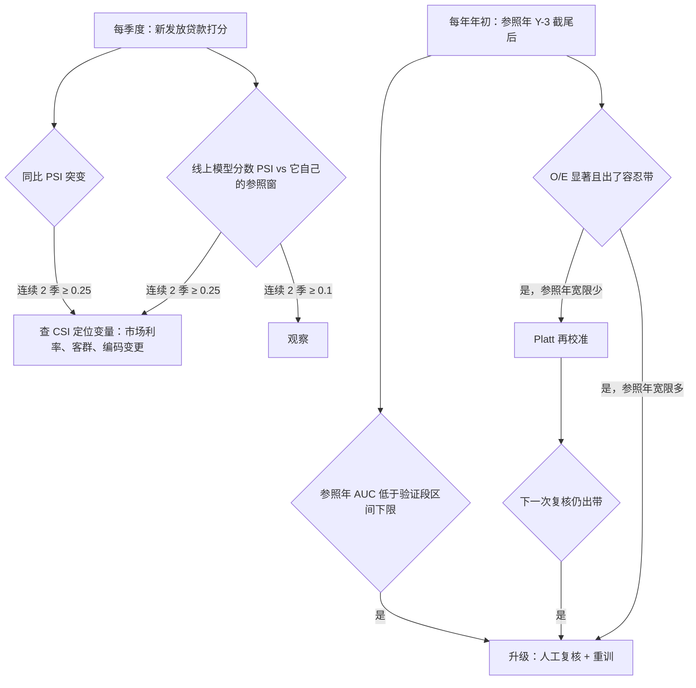

<!-- Template: edit reports/stability.tmpl.md, then `make report`. Every number is a placeholder rendered from outputs/stability.json, outputs/metrics.json or config/. -->

# 跨期稳定性与再校准规则

## 结论

1. **固定模型（2005–2010 训练一次不动）的区分度在下降，但大半是训练集里的危机年份造成的，不全是「老化」。** 每年用最近数据重训（滚动重训）比固定模型显著更好的年份：评分卡 {{stability.rules.scorecard.years_rolling_better}}，LightGBM {{stability.rules.lightgbm.years_rolling_better}}。但只把 {{config.stability.crisis_sensitivity.drop_years}} 年从训练集去掉（其余照旧用老数据），就能拿回很大一部分：评分卡 {{stability.rules.scorecard.years_no_crisis_better}} 年、LightGBM {{stability.rules.lightgbm.years_no_crisis_better}} 年显著更好。滚动重训再比「去掉危机」显著更好的，只有评分卡 {{stability.rules.scorecard.years_rolling_better_than_no_crisis}} 年；LightGBM 没有一年，2024 年反而是「去掉危机」更好（{{stability.rules.lightgbm.years_no_crisis_better_than_rolling}}）。纯「老化」只在评分卡上看得到，而且幅度小于危机样本的影响。
2. **2019–2020 年主样本 AUC 下跌，主要是「事后剔除宽限贷款」带来的样本选择偏差，叠加疫情冲击，不是模型本身的问题。** 主样本剔除了表现期内带宽限标记的贷款，2019 年发放的坏账率因此从 {{stability.annual.2019.sample.bad_rate_incl_assisted:.2%}} 降到 {{stability.annual.2019.sample.bad_rate:.2%}}，大部分潜在违约者被拿掉了。不剔除时，评分卡 2019、2020 年 AUC 是 {{stability.annual.2019.scorecard.incl_assisted.auc:.3f}}、{{stability.annual.2020.scorecard.incl_assisted.auc:.3f}}，高于主样本的 {{stability.annual.2019.scorecard.fixed.auc.est:.3f}}、{{stability.annual.2020.scorecard.fixed.auc.est:.3f}}。滚动重训在这两年仍有提升（评分卡 2019 年 {{stability.annual.2019.scorecard.delta_rolling_minus_fixed.est:.4f}}），但它的训练数据也在疫情前，没法用它单独分出「环境」和「老化」。
3. **训练集含危机年份，是概率偏高的主要来源之一。** 去掉危机年份后平均预测违约率大约减半（2023 年评分卡 {{stability.annual.2023.scorecard.fixed.mean_pred:.2%}} → {{stability.annual.2023.scorecard.no_crisis.mean_pred:.2%}}，实际 {{stability.annual.2023.sample.bad_rate:.2%}}）。
4. **漂移监控要和「线上模型自己的参照窗」比，不能和 2005–2010 的训练期比。** 和训练期比，测试期 {{stability.quarters.test}} 个季度里两个模型都有 {{stability.rules.scorecard.test_quarters_act}} 个超过 {{stability.psi_thresholds.1}}，形同常亮，主因是利率（测试期利率 CSI 平均 {{stability.csi_mean_test.original_interest_rate:.2f}}）。改成「当年线上的滚动模型」和「它自己的参照年」比，评分卡连续两季超 {{stability.psi_thresholds.1}} 的季度落在 2018Q3–2019Q1、2020Q3–2021Q4 和 2023Q2 以后，对应 2018 年底加息、疫情期再融资潮和 2023 年加息后的客群变化。这些是真实的客群移动，所以 R1 的动作是「查原因」，不是直接重训。和上年同季比只作短期突变的辅助信号：它在高利率持续一年后就会熄火（2023Q4 以后不再报警，而固定模型此时仍严重高估）。
5. **按真实滞后跑的再校准闭环校不准，要升级到重训加人工判断。** 第 Y 年年初只能看到 Y−{{config.stability.recalibration.fit_year_back}} 年（表现期已满）的结果。按这个时点逐年回测 R2：没有一年不触发；{{stability.rules.scorecard.years_r2_escalate}} 年的参照年宽限贷款占比超过 {{config.stability.recalibration.max_assisted_share:.0%}}，保护规则拦下了 Platt（不拦的话评分卡 2022 年会从高估变成低估，O/E {{stability.annual.2022.scorecard.recal.oe:.2f}}）。执行后 O/E 落进容忍带（{{config.stability.rules.oe_band.0}}–{{config.stability.rules.oe_band.1}}）的只有 {{stability.rules.scorecard.years_policy_in_band}} 年。违约水平随利率、房价和政策逐年变化，3 年前的数据追不上。

## 设置

- 模型：直接重用 `MULT-415` 的两个模型（同一配置、同一随机种子重训，测试段 AUC 与 `outputs/metrics.json` 一致，代码里有断言）。
- 样本：2005Q1–2024Q2 每个发放季度的主样本（剔除缺陷贷款和窗口内带宽限 / 灾害标记的贷款），共 {{stability.quarters.n}} 个季度，每季度至少 {{stability.quarters.min_loans:,}} 笔，含建模时没用的隔离年。
- 部署时点：回测第 Y 年时假设模型在 Y 年年初上线，只能用到 Y−1 年 12 月前表现期已满的标签（首次还款月 + {{config.target.performance_months}} − 1 个月不晚于 Y−1 年 12 月）。滚动重训、Platt 拟合和 R2、R3 判定都按这个截尾。
- PSI / CSI：分数按参照窗的十分位分箱；CSI 用评分卡入模特征的 WOE 分箱。空箱用一个很小的占比代替以免除零，所以空箱多的变量（如编码改过的渠道）PSI 和 CSI 会偏大，只看相对大小。阈值 {{stability.psi_thresholds.0}} / {{stability.psi_thresholds.1}} 来自常量白名单（行业惯例）。
- 季度 AUC：坏样本不到 {{config.stability.min_bads_for_auc}} 个的季度留空。
- 滚动重训：第 Y 年用 Y−{{config.stability.rolling.train_years_back.0}} 到 Y−{{config.stability.rolling.train_years_back.1}} 年训练，LightGBM 在 Y−{{config.stability.rolling.valid_year_back}} 年（截尾后）早停；训练年和早停年之间不隔离。
- 置信区间：每年有放回重抽 {{config.stability.bootstrap_reps}} 次，同一年各模型变体共用重抽样本，差值是配对的。
- 校准偏离：实际坏样本数和预测坏样本数之差除以其标准差得 z，|z| 超过 {{config.model.evaluation.ci_level:.0%}} 正态分位数为显著。

## 1 按季度 PSI、CSI、AUC

评分卡全部入模特征，按测试期平均 CSI 排序：

| 特征 | 测试期平均 CSI | 峰值（季度） |
| --- | --- | --- |
| `original_interest_rate` | {{stability.csi_mean_test.original_interest_rate:.3f}} | {{stability.csi_peak.original_interest_rate.csi:.3f}}（{{stability.csi_peak.original_interest_rate.quarter}}） |
| `channel` | {{stability.csi_mean_test.channel:.3f}} | {{stability.csi_peak.channel.csi:.3f}}（{{stability.csi_peak.channel.quarter}}） |
| `original_dti` | {{stability.csi_mean_test.original_dti:.3f}} | {{stability.csi_peak.original_dti.csi:.3f}}（{{stability.csi_peak.original_dti.quarter}}） |
| `loan_purpose` | {{stability.csi_mean_test.loan_purpose:.3f}} | {{stability.csi_peak.loan_purpose.csi:.3f}}（{{stability.csi_peak.loan_purpose.quarter}}） |
| `original_upb` | {{stability.csi_mean_test.original_upb:.3f}} | {{stability.csi_peak.original_upb.csi:.3f}}（{{stability.csi_peak.original_upb.quarter}}） |
| `msa` | {{stability.csi_mean_test.msa:.3f}} | {{stability.csi_peak.msa.csi:.3f}}（{{stability.csi_peak.msa.quarter}}） |
| `original_ltv` | {{stability.csi_mean_test.original_ltv:.3f}} | {{stability.csi_peak.original_ltv.csi:.3f}}（{{stability.csi_peak.original_ltv.quarter}}） |
| `mi_pct` | {{stability.csi_mean_test.mi_pct:.3f}} | {{stability.csi_peak.mi_pct.csi:.3f}}（{{stability.csi_peak.mi_pct.quarter}}） |
| `original_cltv` | {{stability.csi_mean_test.original_cltv:.3f}} | {{stability.csi_peak.original_cltv.csi:.3f}}（{{stability.csi_peak.original_cltv.quarter}}） |
| `classic_fico` | {{stability.csi_mean_test.classic_fico:.3f}} | {{stability.csi_peak.classic_fico.csi:.3f}}（{{stability.csi_peak.classic_fico.quarter}}） |
| `original_loan_term` | {{stability.csi_mean_test.original_loan_term:.3f}} | {{stability.csi_peak.original_loan_term.csi:.3f}}（{{stability.csi_peak.original_loan_term.quarter}}） |
| `property_state` | {{stability.csi_mean_test.property_state:.3f}} | {{stability.csi_peak.property_state.csi:.3f}}（{{stability.csi_peak.property_state.quarter}}） |
| `number_of_borrowers` | {{stability.csi_mean_test.number_of_borrowers:.3f}} | {{stability.csi_peak.number_of_borrowers.csi:.3f}}（{{stability.csi_peak.number_of_borrowers.quarter}}） |

- 利率漂移最大，支持 `MULT-415` 留下的假设：模型把高利率读成高风险，而 2023 年后的高利率是市场整体利率，不是借款人风险。
- 渠道（`channel`）是编码变更，不是客群变化：2005–2008 年几乎全部记为「第三方、未细分」，2009 年起拆成经纪和代理两类。评分卡把这个编码切换当成了风险信号，建议在模型里合并这几类（交 `MULT-415` 的后续迭代）。
- 贷款用途在 2023 年跳升，符合加息后再融资消失、购房贷款占比上升；DTI 上移符合放宽 DTI 上限后的人群变化（两条都是推断，未逐条核实）。

## 2 模型老化还是危机样本：固定、去掉危机、滚动重训

AUC 点估计；最后一列是滚动 − 去掉危机的配对差和 {{config.model.evaluation.ci_level:.0%}} 区间，整个大于 0 才算「重训比只去掉危机更好」，也就是纯老化。

| 发放年 | 坏样本 | 评分卡 固定 | 评分卡 去掉危机 | 评分卡 滚动 | 评分卡 滚动 − 去掉危机 | LightGBM 固定 | LightGBM 去掉危机 | LightGBM 滚动 | LightGBM 滚动 − 去掉危机 |
| --- | --- | --- | --- | --- | --- | --- | --- | --- | --- |
| 2017 | {{stability.annual.2017.sample.bads:,}} | {{stability.annual.2017.scorecard.fixed.auc.est:.3f}} | {{stability.annual.2017.scorecard.no_crisis.auc.est:.3f}} | {{stability.annual.2017.scorecard.rolling.auc.est:.3f}} | {{stability.annual.2017.scorecard.delta_rolling_minus_no_crisis.est:.4f}} [{{stability.annual.2017.scorecard.delta_rolling_minus_no_crisis.lo:.4f}}, {{stability.annual.2017.scorecard.delta_rolling_minus_no_crisis.hi:.4f}}] | {{stability.annual.2017.lightgbm.fixed.auc.est:.3f}} | {{stability.annual.2017.lightgbm.no_crisis.auc.est:.3f}} | {{stability.annual.2017.lightgbm.rolling.auc.est:.3f}} | {{stability.annual.2017.lightgbm.delta_rolling_minus_no_crisis.est:.4f}} [{{stability.annual.2017.lightgbm.delta_rolling_minus_no_crisis.lo:.4f}}, {{stability.annual.2017.lightgbm.delta_rolling_minus_no_crisis.hi:.4f}}] |
| 2018 | {{stability.annual.2018.sample.bads:,}} | {{stability.annual.2018.scorecard.fixed.auc.est:.3f}} | {{stability.annual.2018.scorecard.no_crisis.auc.est:.3f}} | {{stability.annual.2018.scorecard.rolling.auc.est:.3f}} | {{stability.annual.2018.scorecard.delta_rolling_minus_no_crisis.est:.4f}} [{{stability.annual.2018.scorecard.delta_rolling_minus_no_crisis.lo:.4f}}, {{stability.annual.2018.scorecard.delta_rolling_minus_no_crisis.hi:.4f}}] | {{stability.annual.2018.lightgbm.fixed.auc.est:.3f}} | {{stability.annual.2018.lightgbm.no_crisis.auc.est:.3f}} | {{stability.annual.2018.lightgbm.rolling.auc.est:.3f}} | {{stability.annual.2018.lightgbm.delta_rolling_minus_no_crisis.est:.4f}} [{{stability.annual.2018.lightgbm.delta_rolling_minus_no_crisis.lo:.4f}}, {{stability.annual.2018.lightgbm.delta_rolling_minus_no_crisis.hi:.4f}}] |
| 2019 | {{stability.annual.2019.sample.bads:,}} | {{stability.annual.2019.scorecard.fixed.auc.est:.3f}} | {{stability.annual.2019.scorecard.no_crisis.auc.est:.3f}} | {{stability.annual.2019.scorecard.rolling.auc.est:.3f}} | {{stability.annual.2019.scorecard.delta_rolling_minus_no_crisis.est:.4f}} [{{stability.annual.2019.scorecard.delta_rolling_minus_no_crisis.lo:.4f}}, {{stability.annual.2019.scorecard.delta_rolling_minus_no_crisis.hi:.4f}}] | {{stability.annual.2019.lightgbm.fixed.auc.est:.3f}} | {{stability.annual.2019.lightgbm.no_crisis.auc.est:.3f}} | {{stability.annual.2019.lightgbm.rolling.auc.est:.3f}} | {{stability.annual.2019.lightgbm.delta_rolling_minus_no_crisis.est:.4f}} [{{stability.annual.2019.lightgbm.delta_rolling_minus_no_crisis.lo:.4f}}, {{stability.annual.2019.lightgbm.delta_rolling_minus_no_crisis.hi:.4f}}] |
| 2020 | {{stability.annual.2020.sample.bads:,}} | {{stability.annual.2020.scorecard.fixed.auc.est:.3f}} | {{stability.annual.2020.scorecard.no_crisis.auc.est:.3f}} | {{stability.annual.2020.scorecard.rolling.auc.est:.3f}} | {{stability.annual.2020.scorecard.delta_rolling_minus_no_crisis.est:.4f}} [{{stability.annual.2020.scorecard.delta_rolling_minus_no_crisis.lo:.4f}}, {{stability.annual.2020.scorecard.delta_rolling_minus_no_crisis.hi:.4f}}] | {{stability.annual.2020.lightgbm.fixed.auc.est:.3f}} | {{stability.annual.2020.lightgbm.no_crisis.auc.est:.3f}} | {{stability.annual.2020.lightgbm.rolling.auc.est:.3f}} | {{stability.annual.2020.lightgbm.delta_rolling_minus_no_crisis.est:.4f}} [{{stability.annual.2020.lightgbm.delta_rolling_minus_no_crisis.lo:.4f}}, {{stability.annual.2020.lightgbm.delta_rolling_minus_no_crisis.hi:.4f}}] |
| 2021 | {{stability.annual.2021.sample.bads:,}} | {{stability.annual.2021.scorecard.fixed.auc.est:.3f}} | {{stability.annual.2021.scorecard.no_crisis.auc.est:.3f}} | {{stability.annual.2021.scorecard.rolling.auc.est:.3f}} | {{stability.annual.2021.scorecard.delta_rolling_minus_no_crisis.est:.4f}} [{{stability.annual.2021.scorecard.delta_rolling_minus_no_crisis.lo:.4f}}, {{stability.annual.2021.scorecard.delta_rolling_minus_no_crisis.hi:.4f}}] | {{stability.annual.2021.lightgbm.fixed.auc.est:.3f}} | {{stability.annual.2021.lightgbm.no_crisis.auc.est:.3f}} | {{stability.annual.2021.lightgbm.rolling.auc.est:.3f}} | {{stability.annual.2021.lightgbm.delta_rolling_minus_no_crisis.est:.4f}} [{{stability.annual.2021.lightgbm.delta_rolling_minus_no_crisis.lo:.4f}}, {{stability.annual.2021.lightgbm.delta_rolling_minus_no_crisis.hi:.4f}}] |
| 2022 | {{stability.annual.2022.sample.bads:,}} | {{stability.annual.2022.scorecard.fixed.auc.est:.3f}} | {{stability.annual.2022.scorecard.no_crisis.auc.est:.3f}} | {{stability.annual.2022.scorecard.rolling.auc.est:.3f}} | {{stability.annual.2022.scorecard.delta_rolling_minus_no_crisis.est:.4f}} [{{stability.annual.2022.scorecard.delta_rolling_minus_no_crisis.lo:.4f}}, {{stability.annual.2022.scorecard.delta_rolling_minus_no_crisis.hi:.4f}}] | {{stability.annual.2022.lightgbm.fixed.auc.est:.3f}} | {{stability.annual.2022.lightgbm.no_crisis.auc.est:.3f}} | {{stability.annual.2022.lightgbm.rolling.auc.est:.3f}} | {{stability.annual.2022.lightgbm.delta_rolling_minus_no_crisis.est:.4f}} [{{stability.annual.2022.lightgbm.delta_rolling_minus_no_crisis.lo:.4f}}, {{stability.annual.2022.lightgbm.delta_rolling_minus_no_crisis.hi:.4f}}] |
| 2023 | {{stability.annual.2023.sample.bads:,}} | {{stability.annual.2023.scorecard.fixed.auc.est:.3f}} | {{stability.annual.2023.scorecard.no_crisis.auc.est:.3f}} | {{stability.annual.2023.scorecard.rolling.auc.est:.3f}} | {{stability.annual.2023.scorecard.delta_rolling_minus_no_crisis.est:.4f}} [{{stability.annual.2023.scorecard.delta_rolling_minus_no_crisis.lo:.4f}}, {{stability.annual.2023.scorecard.delta_rolling_minus_no_crisis.hi:.4f}}] | {{stability.annual.2023.lightgbm.fixed.auc.est:.3f}} | {{stability.annual.2023.lightgbm.no_crisis.auc.est:.3f}} | {{stability.annual.2023.lightgbm.rolling.auc.est:.3f}} | {{stability.annual.2023.lightgbm.delta_rolling_minus_no_crisis.est:.4f}} [{{stability.annual.2023.lightgbm.delta_rolling_minus_no_crisis.lo:.4f}}, {{stability.annual.2023.lightgbm.delta_rolling_minus_no_crisis.hi:.4f}}] |
| 2024Q1–Q2 | {{stability.annual.2024.sample.bads:,}} | {{stability.annual.2024.scorecard.fixed.auc.est:.3f}} | {{stability.annual.2024.scorecard.no_crisis.auc.est:.3f}} | {{stability.annual.2024.scorecard.rolling.auc.est:.3f}} | {{stability.annual.2024.scorecard.delta_rolling_minus_no_crisis.est:.4f}} [{{stability.annual.2024.scorecard.delta_rolling_minus_no_crisis.lo:.4f}}, {{stability.annual.2024.scorecard.delta_rolling_minus_no_crisis.hi:.4f}}] | {{stability.annual.2024.lightgbm.fixed.auc.est:.3f}} | {{stability.annual.2024.lightgbm.no_crisis.auc.est:.3f}} | {{stability.annual.2024.lightgbm.rolling.auc.est:.3f}} | {{stability.annual.2024.lightgbm.delta_rolling_minus_no_crisis.est:.4f}} [{{stability.annual.2024.lightgbm.delta_rolling_minus_no_crisis.lo:.4f}}, {{stability.annual.2024.lightgbm.delta_rolling_minus_no_crisis.hi:.4f}}] |

## 3 危机期和疫情宽限期

按时期汇总（固定模型，PSI 相对训练段）：

| 时期 | 贷款数 | 坏账率 | 评分卡 PSI | 评分卡 AUC | 评分卡 O/E | LightGBM PSI | LightGBM AUC | LightGBM O/E |
| --- | --- | --- | --- | --- | --- | --- | --- | --- |
| 危机期 {{config.stability.periods.crisis.start}}–{{config.stability.periods.crisis.end}} | {{stability.periods.crisis.loans:,}} | {{stability.periods.crisis.bad_rate:.2%}} | {{stability.periods.crisis.scorecard.psi:.3f}} | {{stability.periods.crisis.scorecard.auc:.3f}} | {{stability.periods.crisis.scorecard.oe:.2f}} | {{stability.periods.crisis.lightgbm.psi:.3f}} | {{stability.periods.crisis.lightgbm.auc:.3f}} | {{stability.periods.crisis.lightgbm.oe:.2f}} |
| 疫情宽限期 {{config.stability.periods.covid.start}}–{{config.stability.periods.covid.end}} | {{stability.periods.covid.loans:,}} | {{stability.periods.covid.bad_rate:.2%}} | {{stability.periods.covid.scorecard.psi:.3f}} | {{stability.periods.covid.scorecard.auc:.3f}} | {{stability.periods.covid.scorecard.oe:.2f}} | {{stability.periods.covid.lightgbm.psi:.3f}} | {{stability.periods.covid.lightgbm.auc:.3f}} | {{stability.periods.covid.lightgbm.oe:.2f}} |
| 其余季度 | {{stability.periods.normal.loans:,}} | {{stability.periods.normal.bad_rate:.2%}} | {{stability.periods.normal.scorecard.psi:.3f}} | {{stability.periods.normal.scorecard.auc:.3f}} | {{stability.periods.normal.scorecard.oe:.2f}} | {{stability.periods.normal.lightgbm.psi:.3f}} | {{stability.periods.normal.lightgbm.auc:.3f}} | {{stability.periods.normal.lightgbm.oe:.2f}} |

危机期在训练段里，所以它的 PSI 低、O/E 最接近 1；疫情期 O/E 远低于 1。

**训练时去掉危机年份**（差值 = 去掉危机 − 固定；箭头是平均预测违约率的变化）：

| 发放年 | 评分卡 AUC 差值 | 评分卡 平均预测 | LightGBM AUC 差值 | LightGBM 平均预测 |
| --- | --- | --- | --- | --- |
| 2017 | {{stability.annual.2017.scorecard.delta_no_crisis_minus_fixed.est:.4f}} [{{stability.annual.2017.scorecard.delta_no_crisis_minus_fixed.lo:.4f}}, {{stability.annual.2017.scorecard.delta_no_crisis_minus_fixed.hi:.4f}}] | {{stability.annual.2017.scorecard.fixed.mean_pred:.2%}} → {{stability.annual.2017.scorecard.no_crisis.mean_pred:.2%}} | {{stability.annual.2017.lightgbm.delta_no_crisis_minus_fixed.est:.4f}} [{{stability.annual.2017.lightgbm.delta_no_crisis_minus_fixed.lo:.4f}}, {{stability.annual.2017.lightgbm.delta_no_crisis_minus_fixed.hi:.4f}}] | {{stability.annual.2017.lightgbm.fixed.mean_pred:.2%}} → {{stability.annual.2017.lightgbm.no_crisis.mean_pred:.2%}} |
| 2018 | {{stability.annual.2018.scorecard.delta_no_crisis_minus_fixed.est:.4f}} [{{stability.annual.2018.scorecard.delta_no_crisis_minus_fixed.lo:.4f}}, {{stability.annual.2018.scorecard.delta_no_crisis_minus_fixed.hi:.4f}}] | {{stability.annual.2018.scorecard.fixed.mean_pred:.2%}} → {{stability.annual.2018.scorecard.no_crisis.mean_pred:.2%}} | {{stability.annual.2018.lightgbm.delta_no_crisis_minus_fixed.est:.4f}} [{{stability.annual.2018.lightgbm.delta_no_crisis_minus_fixed.lo:.4f}}, {{stability.annual.2018.lightgbm.delta_no_crisis_minus_fixed.hi:.4f}}] | {{stability.annual.2018.lightgbm.fixed.mean_pred:.2%}} → {{stability.annual.2018.lightgbm.no_crisis.mean_pred:.2%}} |
| 2019 | {{stability.annual.2019.scorecard.delta_no_crisis_minus_fixed.est:.4f}} [{{stability.annual.2019.scorecard.delta_no_crisis_minus_fixed.lo:.4f}}, {{stability.annual.2019.scorecard.delta_no_crisis_minus_fixed.hi:.4f}}] | {{stability.annual.2019.scorecard.fixed.mean_pred:.2%}} → {{stability.annual.2019.scorecard.no_crisis.mean_pred:.2%}} | {{stability.annual.2019.lightgbm.delta_no_crisis_minus_fixed.est:.4f}} [{{stability.annual.2019.lightgbm.delta_no_crisis_minus_fixed.lo:.4f}}, {{stability.annual.2019.lightgbm.delta_no_crisis_minus_fixed.hi:.4f}}] | {{stability.annual.2019.lightgbm.fixed.mean_pred:.2%}} → {{stability.annual.2019.lightgbm.no_crisis.mean_pred:.2%}} |
| 2020 | {{stability.annual.2020.scorecard.delta_no_crisis_minus_fixed.est:.4f}} [{{stability.annual.2020.scorecard.delta_no_crisis_minus_fixed.lo:.4f}}, {{stability.annual.2020.scorecard.delta_no_crisis_minus_fixed.hi:.4f}}] | {{stability.annual.2020.scorecard.fixed.mean_pred:.2%}} → {{stability.annual.2020.scorecard.no_crisis.mean_pred:.2%}} | {{stability.annual.2020.lightgbm.delta_no_crisis_minus_fixed.est:.4f}} [{{stability.annual.2020.lightgbm.delta_no_crisis_minus_fixed.lo:.4f}}, {{stability.annual.2020.lightgbm.delta_no_crisis_minus_fixed.hi:.4f}}] | {{stability.annual.2020.lightgbm.fixed.mean_pred:.2%}} → {{stability.annual.2020.lightgbm.no_crisis.mean_pred:.2%}} |
| 2021 | {{stability.annual.2021.scorecard.delta_no_crisis_minus_fixed.est:.4f}} [{{stability.annual.2021.scorecard.delta_no_crisis_minus_fixed.lo:.4f}}, {{stability.annual.2021.scorecard.delta_no_crisis_minus_fixed.hi:.4f}}] | {{stability.annual.2021.scorecard.fixed.mean_pred:.2%}} → {{stability.annual.2021.scorecard.no_crisis.mean_pred:.2%}} | {{stability.annual.2021.lightgbm.delta_no_crisis_minus_fixed.est:.4f}} [{{stability.annual.2021.lightgbm.delta_no_crisis_minus_fixed.lo:.4f}}, {{stability.annual.2021.lightgbm.delta_no_crisis_minus_fixed.hi:.4f}}] | {{stability.annual.2021.lightgbm.fixed.mean_pred:.2%}} → {{stability.annual.2021.lightgbm.no_crisis.mean_pred:.2%}} |
| 2022 | {{stability.annual.2022.scorecard.delta_no_crisis_minus_fixed.est:.4f}} [{{stability.annual.2022.scorecard.delta_no_crisis_minus_fixed.lo:.4f}}, {{stability.annual.2022.scorecard.delta_no_crisis_minus_fixed.hi:.4f}}] | {{stability.annual.2022.scorecard.fixed.mean_pred:.2%}} → {{stability.annual.2022.scorecard.no_crisis.mean_pred:.2%}} | {{stability.annual.2022.lightgbm.delta_no_crisis_minus_fixed.est:.4f}} [{{stability.annual.2022.lightgbm.delta_no_crisis_minus_fixed.lo:.4f}}, {{stability.annual.2022.lightgbm.delta_no_crisis_minus_fixed.hi:.4f}}] | {{stability.annual.2022.lightgbm.fixed.mean_pred:.2%}} → {{stability.annual.2022.lightgbm.no_crisis.mean_pred:.2%}} |
| 2023 | {{stability.annual.2023.scorecard.delta_no_crisis_minus_fixed.est:.4f}} [{{stability.annual.2023.scorecard.delta_no_crisis_minus_fixed.lo:.4f}}, {{stability.annual.2023.scorecard.delta_no_crisis_minus_fixed.hi:.4f}}] | {{stability.annual.2023.scorecard.fixed.mean_pred:.2%}} → {{stability.annual.2023.scorecard.no_crisis.mean_pred:.2%}} | {{stability.annual.2023.lightgbm.delta_no_crisis_minus_fixed.est:.4f}} [{{stability.annual.2023.lightgbm.delta_no_crisis_minus_fixed.lo:.4f}}, {{stability.annual.2023.lightgbm.delta_no_crisis_minus_fixed.hi:.4f}}] | {{stability.annual.2023.lightgbm.fixed.mean_pred:.2%}} → {{stability.annual.2023.lightgbm.no_crisis.mean_pred:.2%}} |
| 2024Q1–Q2 | {{stability.annual.2024.scorecard.delta_no_crisis_minus_fixed.est:.4f}} [{{stability.annual.2024.scorecard.delta_no_crisis_minus_fixed.lo:.4f}}, {{stability.annual.2024.scorecard.delta_no_crisis_minus_fixed.hi:.4f}}] | {{stability.annual.2024.scorecard.fixed.mean_pred:.2%}} → {{stability.annual.2024.scorecard.no_crisis.mean_pred:.2%}} | {{stability.annual.2024.lightgbm.delta_no_crisis_minus_fixed.est:.4f}} [{{stability.annual.2024.lightgbm.delta_no_crisis_minus_fixed.lo:.4f}}, {{stability.annual.2024.lightgbm.delta_no_crisis_minus_fixed.hi:.4f}}] | {{stability.annual.2024.lightgbm.fixed.mean_pred:.2%}} → {{stability.annual.2024.lightgbm.no_crisis.mean_pred:.2%}} |

**评估时含不含宽限贷款**（固定模型；箭头是剔除 → 含宽限）：

| 发放年 | 坏账率（剔除） | 坏账率（含宽限） | 评分卡 AUC | 评分卡 O/E | LightGBM AUC | LightGBM O/E |
| --- | --- | --- | --- | --- | --- | --- |
| 2017 | {{stability.annual.2017.sample.bad_rate:.2%}} | {{stability.annual.2017.sample.bad_rate_incl_assisted:.2%}} | {{stability.annual.2017.scorecard.fixed.auc.est:.3f}} → {{stability.annual.2017.scorecard.incl_assisted.auc:.3f}} | {{stability.annual.2017.scorecard.fixed.oe:.2f}} → {{stability.annual.2017.scorecard.incl_assisted.oe:.2f}} | {{stability.annual.2017.lightgbm.fixed.auc.est:.3f}} → {{stability.annual.2017.lightgbm.incl_assisted.auc:.3f}} | {{stability.annual.2017.lightgbm.fixed.oe:.2f}} → {{stability.annual.2017.lightgbm.incl_assisted.oe:.2f}} |
| 2018 | {{stability.annual.2018.sample.bad_rate:.2%}} | {{stability.annual.2018.sample.bad_rate_incl_assisted:.2%}} | {{stability.annual.2018.scorecard.fixed.auc.est:.3f}} → {{stability.annual.2018.scorecard.incl_assisted.auc:.3f}} | {{stability.annual.2018.scorecard.fixed.oe:.2f}} → {{stability.annual.2018.scorecard.incl_assisted.oe:.2f}} | {{stability.annual.2018.lightgbm.fixed.auc.est:.3f}} → {{stability.annual.2018.lightgbm.incl_assisted.auc:.3f}} | {{stability.annual.2018.lightgbm.fixed.oe:.2f}} → {{stability.annual.2018.lightgbm.incl_assisted.oe:.2f}} |
| 2019 | {{stability.annual.2019.sample.bad_rate:.2%}} | {{stability.annual.2019.sample.bad_rate_incl_assisted:.2%}} | {{stability.annual.2019.scorecard.fixed.auc.est:.3f}} → {{stability.annual.2019.scorecard.incl_assisted.auc:.3f}} | {{stability.annual.2019.scorecard.fixed.oe:.2f}} → {{stability.annual.2019.scorecard.incl_assisted.oe:.2f}} | {{stability.annual.2019.lightgbm.fixed.auc.est:.3f}} → {{stability.annual.2019.lightgbm.incl_assisted.auc:.3f}} | {{stability.annual.2019.lightgbm.fixed.oe:.2f}} → {{stability.annual.2019.lightgbm.incl_assisted.oe:.2f}} |
| 2020 | {{stability.annual.2020.sample.bad_rate:.2%}} | {{stability.annual.2020.sample.bad_rate_incl_assisted:.2%}} | {{stability.annual.2020.scorecard.fixed.auc.est:.3f}} → {{stability.annual.2020.scorecard.incl_assisted.auc:.3f}} | {{stability.annual.2020.scorecard.fixed.oe:.2f}} → {{stability.annual.2020.scorecard.incl_assisted.oe:.2f}} | {{stability.annual.2020.lightgbm.fixed.auc.est:.3f}} → {{stability.annual.2020.lightgbm.incl_assisted.auc:.3f}} | {{stability.annual.2020.lightgbm.fixed.oe:.2f}} → {{stability.annual.2020.lightgbm.incl_assisted.oe:.2f}} |
| 2021 | {{stability.annual.2021.sample.bad_rate:.2%}} | {{stability.annual.2021.sample.bad_rate_incl_assisted:.2%}} | {{stability.annual.2021.scorecard.fixed.auc.est:.3f}} → {{stability.annual.2021.scorecard.incl_assisted.auc:.3f}} | {{stability.annual.2021.scorecard.fixed.oe:.2f}} → {{stability.annual.2021.scorecard.incl_assisted.oe:.2f}} | {{stability.annual.2021.lightgbm.fixed.auc.est:.3f}} → {{stability.annual.2021.lightgbm.incl_assisted.auc:.3f}} | {{stability.annual.2021.lightgbm.fixed.oe:.2f}} → {{stability.annual.2021.lightgbm.incl_assisted.oe:.2f}} |
| 2022 | {{stability.annual.2022.sample.bad_rate:.2%}} | {{stability.annual.2022.sample.bad_rate_incl_assisted:.2%}} | {{stability.annual.2022.scorecard.fixed.auc.est:.3f}} → {{stability.annual.2022.scorecard.incl_assisted.auc:.3f}} | {{stability.annual.2022.scorecard.fixed.oe:.2f}} → {{stability.annual.2022.scorecard.incl_assisted.oe:.2f}} | {{stability.annual.2022.lightgbm.fixed.auc.est:.3f}} → {{stability.annual.2022.lightgbm.incl_assisted.auc:.3f}} | {{stability.annual.2022.lightgbm.fixed.oe:.2f}} → {{stability.annual.2022.lightgbm.incl_assisted.oe:.2f}} |
| 2023 | {{stability.annual.2023.sample.bad_rate:.2%}} | {{stability.annual.2023.sample.bad_rate_incl_assisted:.2%}} | {{stability.annual.2023.scorecard.fixed.auc.est:.3f}} → {{stability.annual.2023.scorecard.incl_assisted.auc:.3f}} | {{stability.annual.2023.scorecard.fixed.oe:.2f}} → {{stability.annual.2023.scorecard.incl_assisted.oe:.2f}} | {{stability.annual.2023.lightgbm.fixed.auc.est:.3f}} → {{stability.annual.2023.lightgbm.incl_assisted.auc:.3f}} | {{stability.annual.2023.lightgbm.fixed.oe:.2f}} → {{stability.annual.2023.lightgbm.incl_assisted.oe:.2f}} |
| 2024Q1–Q2 | {{stability.annual.2024.sample.bad_rate:.2%}} | {{stability.annual.2024.sample.bad_rate_incl_assisted:.2%}} | {{stability.annual.2024.scorecard.fixed.auc.est:.3f}} → {{stability.annual.2024.scorecard.incl_assisted.auc:.3f}} | {{stability.annual.2024.scorecard.fixed.oe:.2f}} → {{stability.annual.2024.scorecard.incl_assisted.oe:.2f}} | {{stability.annual.2024.lightgbm.fixed.auc.est:.3f}} → {{stability.annual.2024.lightgbm.incl_assisted.auc:.3f}} | {{stability.annual.2024.lightgbm.fixed.oe:.2f}} → {{stability.annual.2024.lightgbm.incl_assisted.oe:.2f}} |

两种口径各有偏差：含宽限时，宽限期内按应还日显示的「逾期」会被算成违约（Freddie Mac 的逾期状态按应还日算）；剔除时，是在事后按表现期内的宽限标记剔除，宽限贷款里本来就多是会出问题的借款人，剔掉后剩下的样本偏好、坏样本很少。2018–2020 年两种口径差异最大，这几年的结论要两种一起看。

## 4 再校准：按真实滞后的逐年闭环

第 Y 年年初：用参照年（Y−{{config.stability.recalibration.fit_year_back}}，截尾后）判定 R2，触发就用参照年做 Platt（对固定模型的 logit 分数做逻辑回归），作用于 Y 年新发放贷款。括号里是参照年的宽限贷款占比；O/E = 实际坏样本 / 预测坏样本，1 为完全校准。

| 发放年 Y | 参照年（宽限占比） | 评分卡 参照年 O/E | 评分卡 R2 | 评分卡 Y 年 O/E：固定 → 执行后 | LightGBM 参照年 O/E | LightGBM R2 | LightGBM Y 年 O/E：固定 → 执行后 |
| --- | --- | --- | --- | --- | --- | --- | --- |
| 2017 | {{stability.annual.2017.reference.vintage}}（{{stability.annual.2017.reference.assisted_share:.1%}}） | {{stability.annual.2017.scorecard.rule.ref_oe:.2f}} | {{stability.annual.2017.scorecard.rule.r2}} | {{stability.annual.2017.scorecard.fixed.oe:.2f}} → {{stability.annual.2017.scorecard.policy.oe:.2f}}（不加保护 {{stability.annual.2017.scorecard.recal.oe:.2f}}） | {{stability.annual.2017.lightgbm.rule.ref_oe:.2f}} | {{stability.annual.2017.lightgbm.rule.r2}} | {{stability.annual.2017.lightgbm.fixed.oe:.2f}} → {{stability.annual.2017.lightgbm.policy.oe:.2f}}（不加保护 {{stability.annual.2017.lightgbm.recal.oe:.2f}}） |
| 2018 | {{stability.annual.2018.reference.vintage}}（{{stability.annual.2018.reference.assisted_share:.1%}}） | {{stability.annual.2018.scorecard.rule.ref_oe:.2f}} | {{stability.annual.2018.scorecard.rule.r2}} | {{stability.annual.2018.scorecard.fixed.oe:.2f}} → {{stability.annual.2018.scorecard.policy.oe:.2f}}（不加保护 {{stability.annual.2018.scorecard.recal.oe:.2f}}） | {{stability.annual.2018.lightgbm.rule.ref_oe:.2f}} | {{stability.annual.2018.lightgbm.rule.r2}} | {{stability.annual.2018.lightgbm.fixed.oe:.2f}} → {{stability.annual.2018.lightgbm.policy.oe:.2f}}（不加保护 {{stability.annual.2018.lightgbm.recal.oe:.2f}}） |
| 2019 | {{stability.annual.2019.reference.vintage}}（{{stability.annual.2019.reference.assisted_share:.1%}}） | {{stability.annual.2019.scorecard.rule.ref_oe:.2f}} | {{stability.annual.2019.scorecard.rule.r2}} | {{stability.annual.2019.scorecard.fixed.oe:.2f}} → {{stability.annual.2019.scorecard.policy.oe:.2f}}（不加保护 {{stability.annual.2019.scorecard.recal.oe:.2f}}） | {{stability.annual.2019.lightgbm.rule.ref_oe:.2f}} | {{stability.annual.2019.lightgbm.rule.r2}} | {{stability.annual.2019.lightgbm.fixed.oe:.2f}} → {{stability.annual.2019.lightgbm.policy.oe:.2f}}（不加保护 {{stability.annual.2019.lightgbm.recal.oe:.2f}}） |
| 2020 | {{stability.annual.2020.reference.vintage}}（{{stability.annual.2020.reference.assisted_share:.1%}}） | {{stability.annual.2020.scorecard.rule.ref_oe:.2f}} | {{stability.annual.2020.scorecard.rule.r2}} | {{stability.annual.2020.scorecard.fixed.oe:.2f}} → {{stability.annual.2020.scorecard.policy.oe:.2f}}（不加保护 {{stability.annual.2020.scorecard.recal.oe:.2f}}） | {{stability.annual.2020.lightgbm.rule.ref_oe:.2f}} | {{stability.annual.2020.lightgbm.rule.r2}} | {{stability.annual.2020.lightgbm.fixed.oe:.2f}} → {{stability.annual.2020.lightgbm.policy.oe:.2f}}（不加保护 {{stability.annual.2020.lightgbm.recal.oe:.2f}}） |
| 2021 | {{stability.annual.2021.reference.vintage}}（{{stability.annual.2021.reference.assisted_share:.1%}}） | {{stability.annual.2021.scorecard.rule.ref_oe:.2f}} | {{stability.annual.2021.scorecard.rule.r2}} | {{stability.annual.2021.scorecard.fixed.oe:.2f}} → {{stability.annual.2021.scorecard.policy.oe:.2f}}（不加保护 {{stability.annual.2021.scorecard.recal.oe:.2f}}） | {{stability.annual.2021.lightgbm.rule.ref_oe:.2f}} | {{stability.annual.2021.lightgbm.rule.r2}} | {{stability.annual.2021.lightgbm.fixed.oe:.2f}} → {{stability.annual.2021.lightgbm.policy.oe:.2f}}（不加保护 {{stability.annual.2021.lightgbm.recal.oe:.2f}}） |
| 2022 | {{stability.annual.2022.reference.vintage}}（{{stability.annual.2022.reference.assisted_share:.1%}}） | {{stability.annual.2022.scorecard.rule.ref_oe:.2f}} | {{stability.annual.2022.scorecard.rule.r2}} | {{stability.annual.2022.scorecard.fixed.oe:.2f}} → {{stability.annual.2022.scorecard.policy.oe:.2f}}（不加保护 {{stability.annual.2022.scorecard.recal.oe:.2f}}） | {{stability.annual.2022.lightgbm.rule.ref_oe:.2f}} | {{stability.annual.2022.lightgbm.rule.r2}} | {{stability.annual.2022.lightgbm.fixed.oe:.2f}} → {{stability.annual.2022.lightgbm.policy.oe:.2f}}（不加保护 {{stability.annual.2022.lightgbm.recal.oe:.2f}}） |
| 2023 | {{stability.annual.2023.reference.vintage}}（{{stability.annual.2023.reference.assisted_share:.1%}}） | {{stability.annual.2023.scorecard.rule.ref_oe:.2f}} | {{stability.annual.2023.scorecard.rule.r2}} | {{stability.annual.2023.scorecard.fixed.oe:.2f}} → {{stability.annual.2023.scorecard.policy.oe:.2f}}（不加保护 {{stability.annual.2023.scorecard.recal.oe:.2f}}） | {{stability.annual.2023.lightgbm.rule.ref_oe:.2f}} | {{stability.annual.2023.lightgbm.rule.r2}} | {{stability.annual.2023.lightgbm.fixed.oe:.2f}} → {{stability.annual.2023.lightgbm.policy.oe:.2f}}（不加保护 {{stability.annual.2023.lightgbm.recal.oe:.2f}}） |
| 2024Q1–Q2 | {{stability.annual.2024.reference.vintage}}（{{stability.annual.2024.reference.assisted_share:.1%}}） | {{stability.annual.2024.scorecard.rule.ref_oe:.2f}} | {{stability.annual.2024.scorecard.rule.r2}} | {{stability.annual.2024.scorecard.fixed.oe:.2f}} → {{stability.annual.2024.scorecard.policy.oe:.2f}}（不加保护 {{stability.annual.2024.scorecard.recal.oe:.2f}}） | {{stability.annual.2024.lightgbm.rule.ref_oe:.2f}} | {{stability.annual.2024.lightgbm.rule.r2}} | {{stability.annual.2024.lightgbm.fixed.oe:.2f}} → {{stability.annual.2024.lightgbm.policy.oe:.2f}}（不加保护 {{stability.annual.2024.lightgbm.recal.oe:.2f}}） |

- R2 取值：recalibrate 是做 Platt；escalate 是参照年宽限占比超过 {{config.stability.recalibration.max_assisted_share:.0%}}，不做 Platt，升级到人工复核和重训。
- Platt 在每一年都降低了 Brier 分数（评分卡 {{stability.rules.scorecard.years_recal_brier_better}}），但执行后 O/E 进入容忍带的只有 {{stability.rules.scorecard.years_policy_in_band}} 年（LightGBM {{stability.rules.lightgbm.years_policy_in_band}} 年）。
- 滚动重训的模型同样不准：它学的是 5 年训练窗的平均违约水平，同样跟不上逐年变化。

## 5 再校准触发规则

| 规则 | 数据 | 触发条件 | 动作 | 回测（2017–2024Q2，按部署时点） |
| --- | --- | --- | --- | --- |
| R1 分数漂移（主） | 当季新发放，不需要标签 | 线上模型分数和它自己的参照窗比，连续 {{config.stability.rules.consecutive_quarters}} 季 ≥ {{stability.psi_thresholds.1}} 行动、≥ {{stability.psi_thresholds.0}} 观察 | 用 CSI 查原因 | 评分卡行动 {{stability.rules.scorecard.ref_rolling_fired_act}}；LightGBM 行动 {{stability.rules.lightgbm.ref_rolling_fired_act}} |
| R1b 同比突变（辅） | 同上 | 和上年同季比，连续 {{config.stability.rules.consecutive_quarters}} 季 ≥ {{stability.psi_thresholds.1}} | 同上 | 评分卡 {{stability.rules.scorecard.yoy_fired_act}}；LightGBM {{stability.rules.lightgbm.yoy_fired_act}} |
| R2 校准偏离 | 参照年 Y−{{config.stability.recalibration.fit_year_back}}（截尾后） | O/E 的 z 超出 {{config.model.evaluation.ci_level:.0%}} 区间，且 O/E 出了 {{config.stability.rules.oe_band.0}}–{{config.stability.rules.oe_band.1}} | 参照年宽限占比不超过 {{config.stability.recalibration.max_assisted_share:.0%}} 做 Platt，否则升级 | 评分卡 Platt {{stability.rules.scorecard.years_r2_recalibrate}}、升级 {{stability.rules.scorecard.years_r2_escalate}} |
| R3 区分度下降 | 同上 | 参照年 AUC 低于验证段 AUC 区间下限 | 重训 | 评分卡 {{stability.rules.scorecard.years_retrain}}；LightGBM {{stability.rules.lightgbm.years_retrain}} |

- 阈值：PSI 的 {{stability.psi_thresholds.0}} / {{stability.psi_thresholds.1}} 来自常量白名单；连续季度数、O/E 容忍带、宽限占比上限和置信水平是本项目的设置（`config/stability.yaml`、`config/model.yaml`）。
- R1 的「参照窗」就是线上模型最近一次重训或再校准用的那一年。回测里线上模型按每年滚动重训算。
- R2、R3 有天然滞后：Y 年发放的贷款到 Y+{{config.stability.recalibration.fit_year_back}} 年初才能拿来判定，这正是 R1 的价值。
- 回测结论：R2 年年触发、执行后多数年份仍出带，R3 多数年份触发。固定模型加年度 Platt 不够，建议改成每年重训（训练集不含危机年份），加上利率等宏观因素的人工判断。

## 局限

- 主样本每年 5 万笔抽样，2019–2021 年坏样本只有一两百个，逐年区间宽。2020、2021 年的全量数据已下载，可以用来复核这两年，本单没做。
- 再校准只试了 Platt 一种。按利率分层校准、或用相对利率（借款利率减当期市场利率）代替绝对利率，可能更好，留给后续。
- 端到端测试只覆盖了辅助函数和截尾、R2 判定逻辑，`quarterly`、`annual` 没有合成数据的整体测试。
